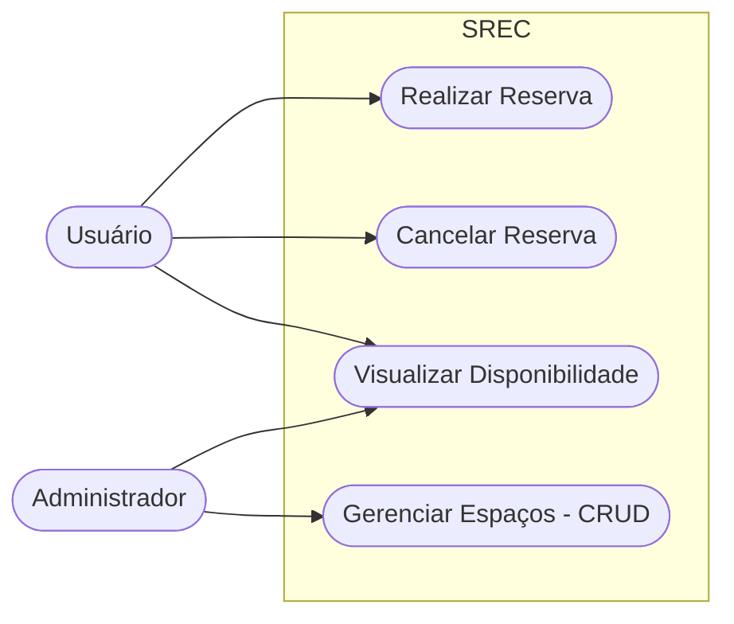
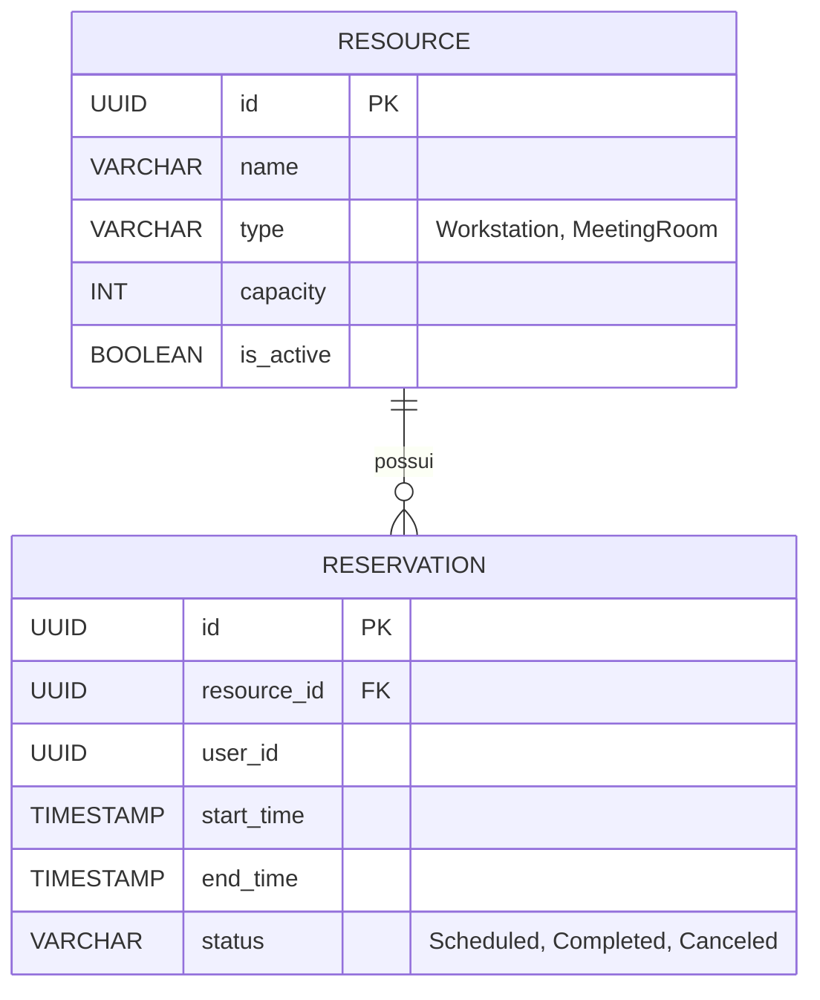

# Documentação Oficial SREC

## 1. Visão Geral do Projeto

O SREC - Sistema de Reserva de Espaços e Coworking - é uma solução web centralizada projetada para resolver desafios comuns em espaços compartilhados, como conflitos de horários, tentativas de uso simultâneo do mesmo recurso, falta de visibilidade em tempo real do status das salas e as falhas geradas pela gestão manual através de planilhas.

O produto oferece automatização total de disponibilidade e agendamento para dois principais tipos de recursos:

* **Estações de Trabalho:** Foco individual, com controle por capacidade unitária.

* **Salas de Reunião:** Foco colaborativo, com controle de capacidade em grupo.

## 2. Equipe e Papéis

| Membro | Papel | Responsabilidades Principais | 
 | ----- | ----- | ----- | 
| **Maria Eduarda Huida** | Product Owner & Requisitos | Engenharia de requisitos, Casos de Uso, Histórias de Usuário, Modelagem UML. | 
| **Lucas Giovani Fruck** | Backend & QA | Arquitetura de API estruturada em Node.js e Express, Persistência no PostgreSQL, Regras de Negócio e Testes Unitários via Jest. | 
| **Gustavo José Paulo** | Frontend & DevOps | Interface feita em React e Vite, UI/UX, CI/CD através do GitHub Actions, Linting e Padrões de Qualidade de Código. | 

## 3. Engenharia de Requisitos

### 3.1. User Stories Principais

* **US01 - Cadastro Base:** Gestão e controle de espaços disponíveis, como estações de trabalho e salas de reunião.

* **US02/03 - Agendamento:** Garantia de disponibilidade em tempo real sem sobreposição de horários.

### 3.2. Ciclo de Vida da Reserva

O status de uma reserva passa pelas seguintes etapas lógicas no sistema:
`Agendado -> Concluído ou Cancelado`

### 3.3. Diagrama de Casos de Uso



## 4. Arquitetura e Regras de Negócio

### 4.1. Stack Tecnológico

* **Backend:** Node.js + Express seguindo o padrão estrutural MVC e REST.

* **Banco de Dados:** PostgreSQL com tabelas relacionais.

* **Quality Assurance:** Testes unitários automatizados de domínio via Jest.

### 4.2. Validação Matemática Crítica anti-sobreposição

O núcleo do sistema de reservas depende da seguinte regra lógica para garantir que duas reservas não ocupem o mesmo espaço no mesmo horário:

```text
Início_banco < Fim_novo AND Fim_banco > Início_novo
```

Se a condição acima for verdadeira ao consultar o banco de dados, significa que há conflito de horários e a nova reserva deve ser bloqueada.

### 4.3. Modelo Entidade-Relacionamento - MER



## 5. Esboço da Documentação da API REST

### Recursos - Resources

| Método | Endpoint | Descrição | 
 | ----- | ----- | ----- | 
| `GET` | `/api/resources` | Lista todos os espaços disponíveis. | 
| `POST` | `/api/resources` | Cadastra um novo espaço - Nível de acesso Admin. | 

### Reservas - Reservations

| Método | Endpoint | Descrição | 
 | ----- | ----- | ----- | 
| `POST` | `/api/reservations` | Cria uma nova reserva validando a sobreposição. | 
| `GET` | `/api/reservations` | Lista as reservas do usuário atual. | 
| `PUT` | `/api/reservations/{id}/cancel` | Cancela uma reserva existente. | 

## 6. Frontend, DevOps e Padrões de Engenharia

### 6.1. Interface UI/UX

* Construída em **React e Vite** para máxima performance.

* Design responsivo com abas interativas para navegação facilitada.

* Feedback dinâmico e em tempo real sobre a disponibilidade das salas.

### 6.2. Pipeline de Integração Contínua CI/CD

* Executada via **GitHub Actions**.

* Automação rigorosa de linters e testes a cada novo commit ou pull request.

* Bloqueio preventivo de código falho, impedindo deploys quebrados.

### 6.3. Padrões Adotados pela Equipe

* **Clean Code:** Separação estrita de responsabilidades no backend e frontend.

* **Qualidade de Código:** Padronização visual garantida por ESLint e Prettier.

* **Git Flow:** Utilização de branches estruturadas como main, develop e feature/, além de commits semânticos.

* **Rastreabilidade:** Todas as tarefas de desenvolvimento são mapeadas com critérios de aceite no Jira.

## 7. Guia de Contribuição

Para manter o sistema robusto e preparado para evolução escalar, todos os desenvolvedores devem seguir o fluxo abaixo:

1. Certifique-se de que sua tarefa issue está atualizada no Jira.

2. Crie uma branch a partir da develop utilizando o formato feature/numero-da-task-descricao.

3. Escreva os testes unitários no backend para qualquer nova regra de negócio adicionada.

4. Rode o ESLint e Prettier localmente antes do commit.

5. Ao abrir o Pull Request, aguarde a aprovação do CI GitHub Actions e a revisão de pelo menos um colega antes de realizar o merge.
