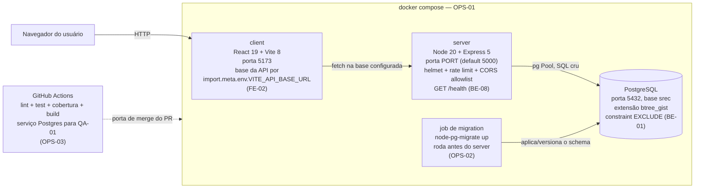
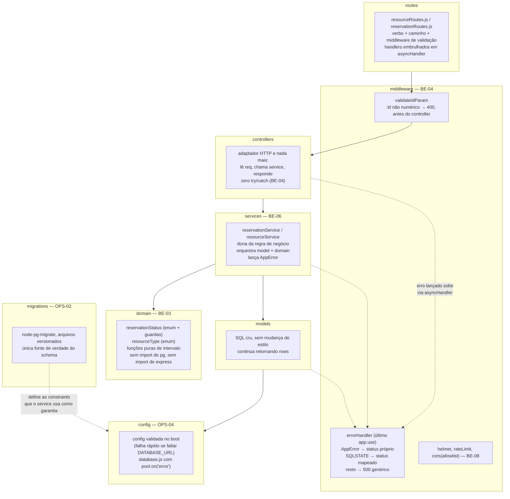
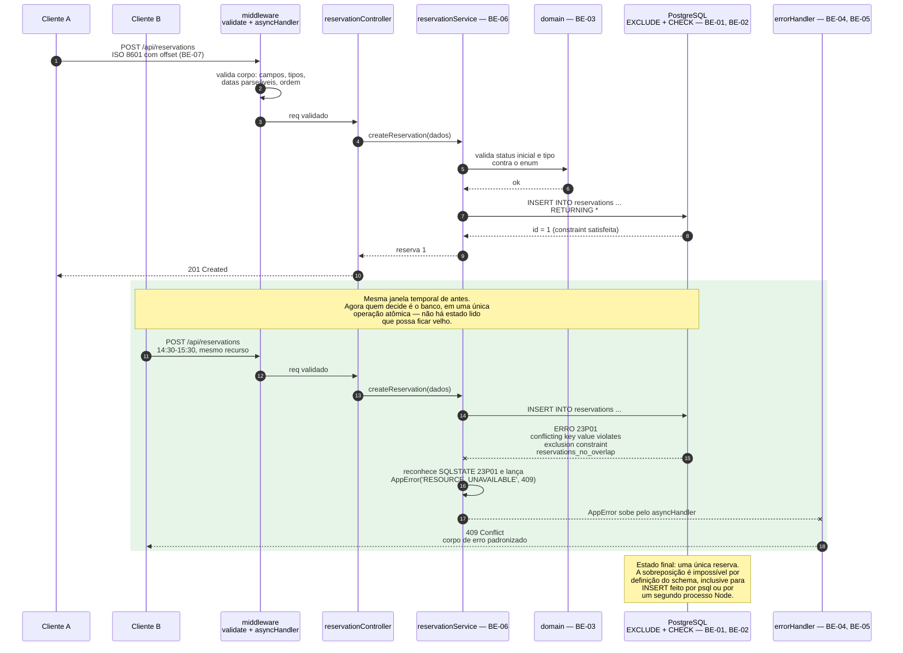
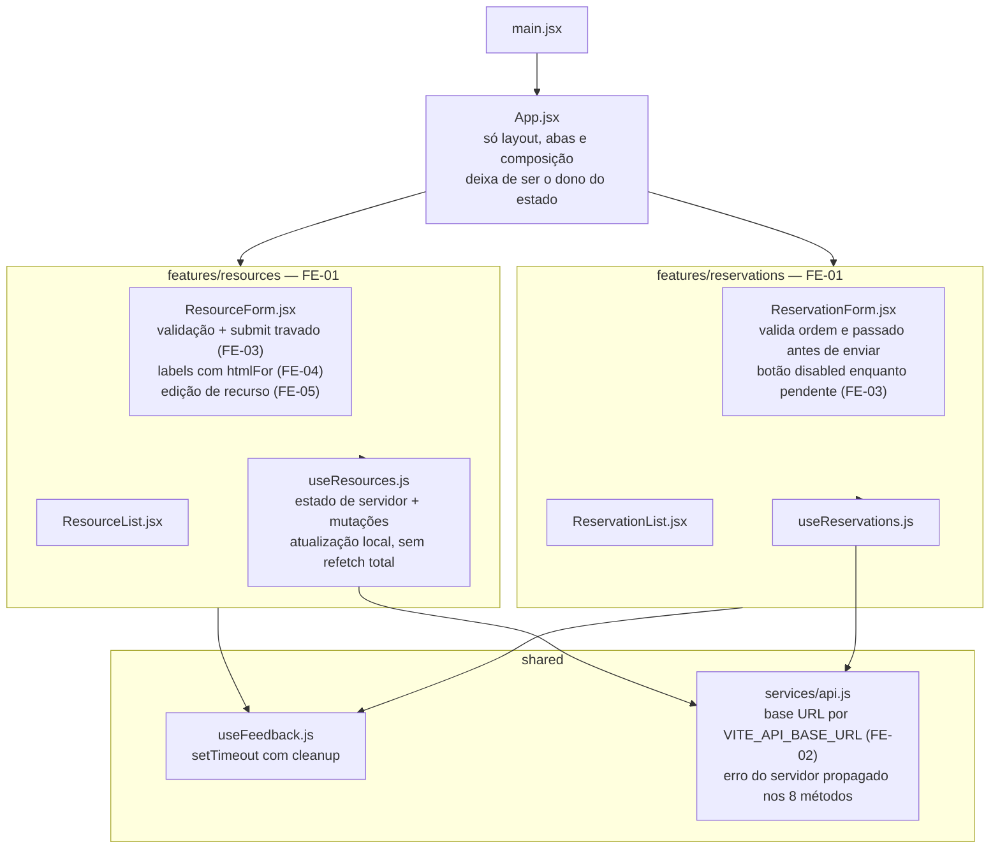

# Arquitetura alvo do SREC ao fim da N2

Este documento descreve o sistema **depois** das specs de implementação da N2.
Tudo aqui é **alvo**: nada neste arquivo descreve código que já existe no
repositório, exceto quando o texto diz explicitamente que não muda. O retrato
do que existe hoje está em [estado-atual.md](estado-atual.md).

Cada mudança é entregue por uma spec identificada (`BE-*`, `FE-*`, `OPS-*`,
`QA-*`) em `docs/specs/<slug>/implementacao.md`. Este documento referencia os
IDs e **não** reescreve o conteúdo delas: a spec é a casa canônica da
implementação, aqui mora só o desenho.

O princípio que define o escopo: **a N2 é manutenção com prazo curto, e
reescrita não é refatoração.** O alvo é o mesmo sistema, com as invariantes no
lugar certo e as camadas separadas o suficiente para serem testáveis — não um
sistema novo.

## Componentes alvo



As três peças de runtime continuam as mesmas, nas mesmas portas. O que entra é
o que estava faltando em volta: um compose que sobe tudo com um comando
(OPS-01), um passo de migration que é o único a tocar o schema (OPS-02), uma CI
que reprova PR que piore a qualidade (OPS-03) e uma configuração que falha no
boot se estiver incompleta (OPS-04).

O `initDb.js` **sai do caminho de boot**: o `index.js` não chama mais
`await initDb()` antes do `listen`. O schema passa a ser estado do banco
gerenciado por migration, não efeito colateral da subida do processo.

## Camadas alvo do backend



O que cada camada nova faz:

* **`domain/`** — funções puras e constantes. O enum de status
  (`'scheduled' | 'cancelled' | 'completed'`) e o de tipo de recurso
  (`'workstation' | 'meeting_room'`) passam a existir uma vez, em código, e o
  mesmo conjunto de valores é espelhado no `CHECK` do banco pela migration.
  Mata os literais soltos (CS-05). É a camada que QA-02 testa, porque não
  precisa de banco nem de HTTP: a cobertura de domínio vira barata.
* **`services/`** — a regra de negócio sai do controller. `reservationService`
  é quem decide o que é uma reserva válida, chama o model e traduz violação de
  constraint em erro de domínio. É aqui que o 409 nasce. Resolve CS-03 e é o
  que torna a regra testável sem Express.
* **`middleware/`** — duas peças: `validateIdParam`, que rejeita `:id` não
  numérico com 400 **antes** de qualquer query (mata BUG-04 nas 6 rotas), e
  `errorHandler`, o único lugar do backend que decide status HTTP a partir de
  erro. Com `asyncHandler` embrulhando os handlers, os 10 `try/catch` idênticos
  desaparecem (CS-02).
* **`migrations/`** — arquivos versionados e ordenados. Toda alteração de
  schema é um arquivo revisado em PR, aplicável em qualquer máquina e no CI.
  Substitui `CREATE TABLE IF NOT EXISTS` (CS-06) e tira o erro engolido de
  `initDb.js:28-30` do caminho crítico (BUG-11).

Os `controllers/` **encolhem** até virar adaptador: ler `req`, chamar o
service, devolver o status. Os `models/` **não mudam de estilo** — continuam
SQL cru, e isso é deliberado (ADR-002 em [decisoes.md](decisoes.md)).

## Fluxo alvo: criação de reserva com a janela fechada

A diferença estrutural: a garantia muda de lugar. Hoje ela é um `SELECT` da
aplicação; no alvo ela é uma constraint do banco, e a aplicação apenas
**traduz** a violação para HTTP.



O que esse desenho compra, ponto por ponto:

* **Não há mais TOCTOU**, porque não há mais "time of check" separado do "time
  of use": o `INSERT` é a verificação. Some a necessidade de transação
  explícita e, com ela, a necessidade de expor `pool.connect()` em
  `database.js`.
* **A garantia vale para todo mundo**, não só para quem passa pelo controller.
  Script, `psql`, migration de dados, segundo processo — todos batem na mesma
  constraint.
* **O 409 passa a ser derivado de fato**, não de opinião: ele vem do SQLSTATE
  `23P01` (`exclusion_violation`), que o Postgres só emite quando houve de
  verdade uma sobreposição. O mapeamento vive em um lugar só (BE-04/BE-05).
* `checkAvailability` **continua existindo**, mas muda de papel: deixa de ser o
  mecanismo de garantia e passa a ser consulta de leitura — serve para o front
  avisar antes de enviar e para mensagem de erro mais útil. Se ela der um falso
  "disponível" por corrida, o banco recusa de qualquer forma. Os 2 testes
  existentes continuam válidos; QA-01 acrescenta o teste de concorrência que
  **falha antes** da constraint existir.

## Schema alvo

Entregue por migrations versionadas (OPS-02); o conteúdo exato de cada
migration está nas specs BE-01, BE-02, BE-03 e BE-07. O desenho:

```sql
CREATE EXTENSION IF NOT EXISTS btree_gist;

-- resources
--   type e capacity passam a ter invariante no banco
--   created_at/updated_at em TIMESTAMPTZ

-- reservations
--   start_time/end_time em TIMESTAMPTZ (BE-07)
--   CHECK (end_time > start_time)                       -- BE-02
--   CHECK (status IN ('scheduled','cancelled','completed'))  -- BE-03
--   EXCLUDE USING gist (
--     resource_id WITH =,
--     tstzrange(start_time, end_time) WITH &&
--   ) WHERE (status <> 'cancelled')                     -- BE-01
```

As garantias que passam a existir, e o que cada uma impede:

* `btree_gist` + `EXCLUDE ... USING gist` em
  `(resource_id =, tstzrange(start_time, end_time) &&)` com predicado
  `status <> 'cancelled'` — a sobreposição vira erro `23P01`. Preserva o
  comportamento atual de que reserva cancelada libera o horário
  (`reservationModel.js:53` já filtra `status != 'cancelled'`). **BE-01**.
* `CHECK (end_time > start_time)` — fecha a janela invertida e, com ela, o
  caso em que uma reserva não colide com nada por ser inválida. **BE-02**.
* `CHECK (status IN (...))` espelhando o enum de `domain/` — o `PATCH
  /:id/status` deixa de aceitar string arbitrária mesmo se a validação da
  aplicação falhar. **BE-03**.
* `TIMESTAMPTZ` em todas as colunas de tempo e contrato de API em ISO 8601 com
  offset — o instante deixa de depender do fuso de quem gravou. **BE-07**.
* Índices: o `EXCLUDE` cria um índice GiST em `(resource_id, tstzrange(...))`,
  que é exatamente o acesso de `checkAvailability` e de `findByResourceId`.
  O índice vem como subproduto da constraint, não como otimização separada —
  resolve CS-09 sem acrescentar nada.

Para registro: hoje o schema tem **0 `CHECK`**, **0 `UNIQUE`**,
**0 `EXCLUDE`** e **0 índices além das 2 PKs**. O alvo tem **1 `EXCLUDE`** e
pelo menos **2 `CHECK`** em `reservations`, mais o índice GiST que a constraint
cria.

## Frontend alvo



O que muda no desenho:

* **`App.jsx` deixa de ser o sistema.** As 351 linhas se dividem por feature;
  o componente raiz fica com layout, cabeçalho e troca de aba. Mata CS-01, e é
  o pré-requisito para corrigir BUG-13 e BUG-14 em um lugar só em vez de em um
  arquivo de 351 linhas.
* **Os 12 `useState` se separam por responsabilidade.** Estado de servidor vai
  para os hooks de feature (`useResources`, `useReservations`); estado de
  formulário fica no componente de formulário; feedback vai para
  `useFeedback`, que guarda o id do `setTimeout` e limpa no unmount
  (BUG-14).
* **`loadData()` morre como estratégia.** Hoje são 5 handlers chamando refetch
  total, a 3 viagens de rede por mutação. No alvo cada hook atualiza sua
  própria lista com o que a API devolveu no `RETURNING *`, e recarrega só o que
  precisa (CS-08).
* **Os 2 `eslint-disable-next-line`** do `useEffect` (`App.jsx:54` e
  `App.jsx:56`) deixam de ser necessários, porque a carga inicial fica dentro
  do hook com as dependências corretas (CS-12).
* **Os 7 `<label>` sem `htmlFor`** ganham `htmlFor`/`id` pareados, mais estado
  de erro anunciável; é FE-04 e resolve CS-13.
* **`api.js` passa a ler a base da URL de `import.meta.env`** (FE-02),
  tornando o `dist` transportável, e uniformiza a propagação de erro: hoje 3
  dos 8 métodos leem `err.error` do corpo e 5 jogam a mensagem do servidor
  fora. No alvo os 8 propagam.
* **`PUT /api/resources/:id` deixa de ser órfão**: FE-05 entrega a tela de
  edição que consome o `api.updateResource` já existente (BUG-15), e BE-06
  conserta a semântica de corpo parcial do lado do servidor (BUG-05).

## Mapa de mudança → spec → defeito

| Mudança arquitetural | Spec | Mata |
|---|---|---|
| Constraint `EXCLUDE` com `btree_gist`; garantia sai da aplicação e vai para o banco | BE-01 | BUG-01, e o agravante de BUG-13 no servidor |
| `CHECK (end_time > start_time)` na tabela de reservas | BE-02 | BUG-02 |
| Enum de status em `domain/` espelhado por `CHECK` no banco | BE-03 | BUG-03, CS-05 |
| `AppError` + `asyncHandler` + `errorHandler` central; `validateIdParam` | BE-04 | BUG-04, CS-02, parte de CS-04 |
| Mapeamento SQLSTATE → HTTP e revisão dos códigos de resposta | BE-05 | BUG-04, 409 derivado de `23P01` |
| Camada `services/` com a regra de negócio e update parcial coerente | BE-06 | BUG-05, CS-03 |
| `TIMESTAMPTZ` no banco e ISO 8601 com offset no contrato | BE-07 | BUG-07 |
| `helmet`, rate limit, CORS por allowlist, `GET /health` | BE-08 | CS-14 |
| Quebra de `App.jsx` por feature, com hooks de estado de servidor | FE-01 | CS-01, CS-08, CS-12, BUG-14 |
| Base da API por variável de ambiente do Vite | FE-02 | CS-07 |
| Validação no formulário e trava de envio enquanto pendente | FE-03 | BUG-13, parte de CS-04 |
| Rótulos associados, foco e anúncio de erro | FE-04 | CS-13 |
| Tela de edição de recurso | FE-05 | BUG-15 |
| `docker compose` com server, client e Postgres | OPS-01 | onboarding manual do `README.md:40-63` |
| Migrations com `node-pg-migrate`; `initDb.js` fora do boot | OPS-02 | CS-06, BUG-11 |
| Portões de qualidade na CI, com limiar de cobertura e gatilho correto | OPS-03 | CS-10, e a CI que aponta para o `develop` inexistente |
| Configuração validada no boot, falha rápido | OPS-04 | parte de BUG-11 |
| Proteção de branch, CODEOWNERS e templates de issue/PR | OPS-05 | aprovação do QA exigida pela rubrica |
| Suíte de integração com Supertest contra Postgres real | QA-01 | 0 % de cobertura em controllers e rotas; prova BUG-01 antes e depois |
| Testes de domínio sobre `domain/` | QA-02 | 0 % de branches; CS-05 |

Linha de base para medir o depois: statements **6,14 %**, branches **0 %**,
funções **3,57 %**, **1** arquivo de teste, **2** casos, **0** testes de
frontend. `supertest` já está em `server/package.json:32` e não é usado por
nenhum arquivo — QA-01 começa de uma dependência já instalada.

### Defeitos que o alvo da N2 não cobre

Honestidade de escopo: os itens abaixo estão catalogados, **não** têm spec
atribuída nesta entrega e vão para `docs/handoff/` como débito do grupo da N3.
Dizer que o alvo os resolve seria falso.

* **BUG-06** — `ON DELETE CASCADE` em `reservations.resource_id`
  (`initDb.js:16`) apaga o histórico junto com o recurso. A saída natural é
  `ON DELETE RESTRICT` mais a coluna `is_active` que o MER recebido documenta e
  o código nunca teve — mas isso muda o comportamento do `DELETE` que o front
  já usa, e mudança de comportamento visível não entra sem repriorização do PO.
* **BUG-08** — reserva no passado continua aceita pelo servidor. FE-03 bloqueia
  no formulário, o que resolve o caminho de uso normal mas não a API. Sem
  `CHECK` nem validação de serviço, um `POST` direto ainda passa.
* **BUG-09** e **BUG-10** — `capacity` 0/negativa e `type` arbitrário. A
  invariante correta é `CHECK (capacity > 0)` e
  `CHECK (type IN ('workstation','meeting_room'))`. Cabem numa migration de
  OPS-02, mas nenhuma spec da N2 as declara como entrega, então ficam
  registradas como alvo sem dono.
* **BUG-12** — `pool.on('error')` ausente em `database.js`. É uma linha, e
  ainda assim não está em nenhuma spec; o lugar natural é o endurecimento de
  configuração de OPS-04.
* **CS-11** — `client.txt`, `server.txt` e `shared.txt` com 0 byte
  versionados. Limpeza, sem spec.

## O que deliberadamente não muda

A tentação, ao receber código alheio com 15 bugs catalogados, é reescrever. A
N2 não reescreve, e cada "não" abaixo é uma decisão com justificativa em
[decisoes.md](decisoes.md):

* **Continua Express 5 com `pg` e SQL cru. Sem ORM.** Trocar para Prisma,
  Sequelize ou Knex reescreveria 108 linhas de model que **funcionam** e cuja
  única falha real é não ter constraint abaixo delas. Além disso, a correção
  central da N2 é uma constraint `EXCLUDE` com `btree_gist` — justo o tipo de
  recurso que ORM costuma não modelar bem, e que exigiria SQL cru dentro do ORM
  de qualquer forma. Custo aceito: continuamos montando string SQL na mão.
  ADR-002.
* **Continua sem autenticação.** A documentação recebida marca
  `POST /api/resources` como "Nível de acesso Admin" e o diagrama de casos de
  uso separa Usuário de Administrador — nada disso jamais existiu no código:
  não há tabela de usuário, não há sessão, `reservations.user_name` é um
  `VARCHAR(100)` digitado em um `<input type="text">` (`App.jsx:252-259`).
  Introduzir identidade significa modelar usuário, trocar `user_name` por FK,
  migrar dado, criar login no front e proteger 10 rotas. É uma feature, não um
  bug — e é o débito prioritário número 1 da N3. O que a N2 faz é **corrigir a
  documentação** para parar de prometer o que não existe. ADR-007.
* **Continua sem DDD.** Entra uma pasta `domain/` com enums e funções puras, e
  uma `services/` com a regra. Não entram entidades ricas, agregados, value
  objects, repositórios com interface, nem inversão de dependência. O objetivo
  de `domain/` é ter **onde** testar a regra sem banco (QA-02), não implantar
  um estilo arquitetural em um sistema de 2 tabelas. ADR-004.
* **Continua sem roteador e sem gerenciador de estado global no front.** As
  abas permanecem estado local de `App.jsx`; a quebra é por feature com hooks,
  não por rota. Custo aceito: a aba continua não estando na URL e não é
  compartilhável por link. ADR-012.
* **Continua com duas tabelas e `SERIAL` como PK.** O MER recebido documenta
  `UUID`; o código usa `SERIAL`. Migrar o tipo da chave primária de duas
  tabelas, com FK entre elas, para ganhar nada em um sistema sem distribuição
  nem exposição de id, é risco puro. A divergência é resolvida **corrigindo o
  MER**, não o banco. ADR-013.
* **`checkAvailability` não é removida.** Ela deixa de ser a garantia, mas
  continua útil como leitura — e os 2 testes existentes, que são todo o
  patrimônio de teste recebido, continuam passando.

A regra que fecha o escopo: toda mudança da N2 tem que ser defensável com um
número antes e um número depois. O que não pode ser medido na janela até 23/10
não entra nesta entrega — entra no handoff.
