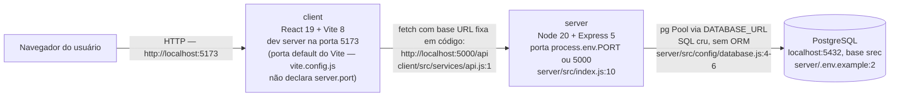
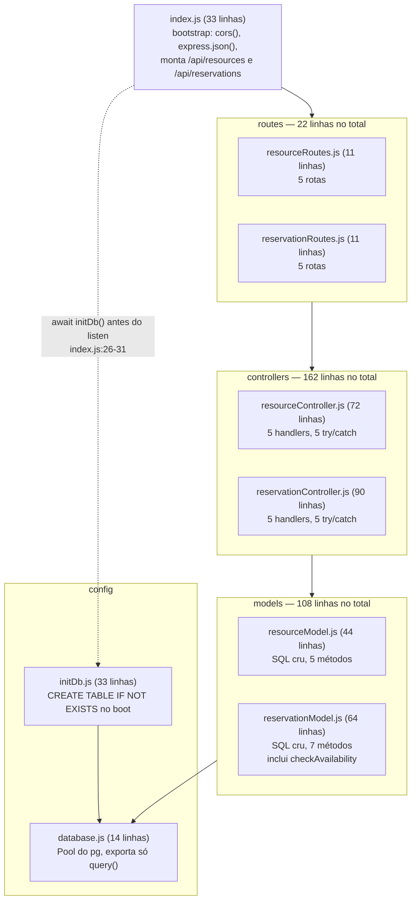
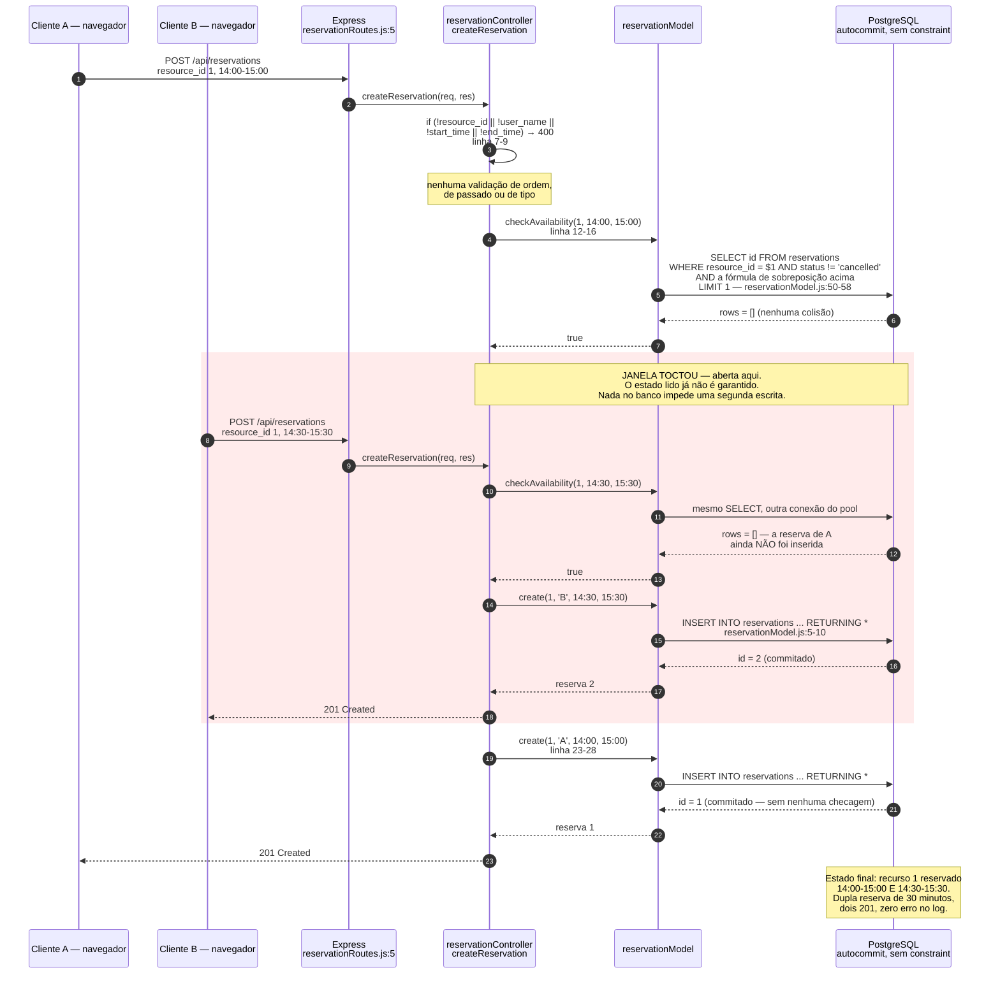
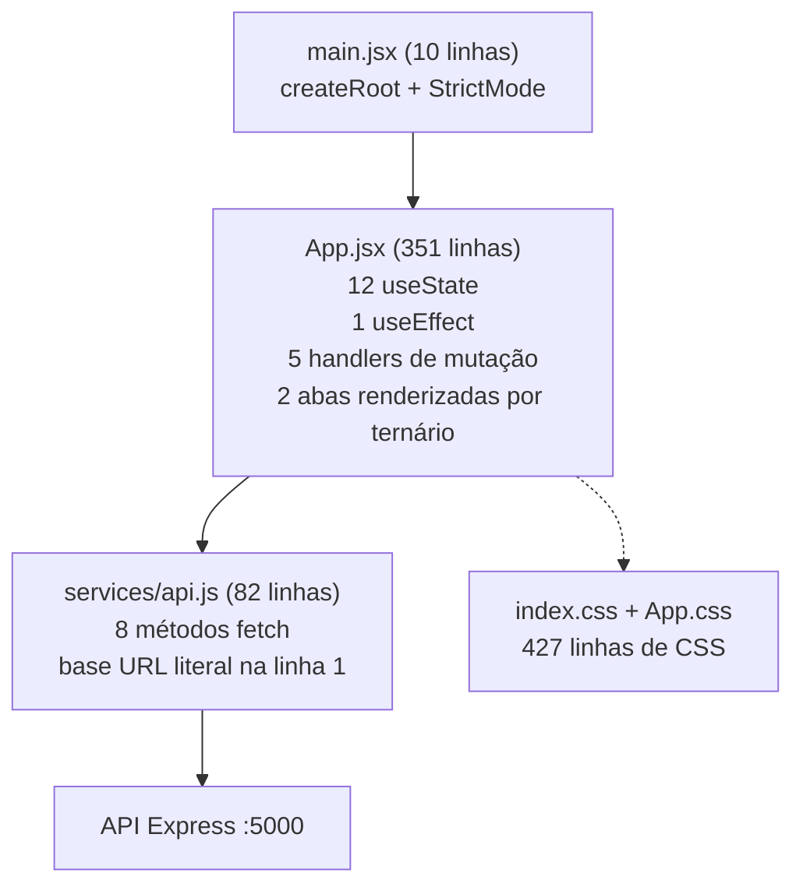

# Arquitetura atual do SREC

Engenharia reversa do sistema recebido do grupo anterior, feita por leitura do
código em `server/src/` e `client/src/`. Nada aqui foi inferido da
`Documentação Oficial SREC.md`: onde o documento recebido divergir do código,
vale o código, e a divergência está catalogada em `docs/auditoria/`.

Número de referência para o resto deste documento: **1.280 linhas** de fonte
(js/jsx/css, sem lock), das quais **853 linhas** de JS/JSX. O maior arquivo é
`client/src/App.jsx`, com **351 linhas** — 41 % de todo o JS/JSX do projeto.

## Componentes e portas reais



Três processos, nenhum containerizado: não existe `Dockerfile` nem
`docker-compose.yml` no repositório recebido. O onboarding é manual e está
descrito em `README.md:40-63` — criar a base `srec` na mão, copiar
`server/.env.example` para `server/.env`, `npm install` em duas pastas.

O acoplamento mais caro desse desenho está na seta do meio: a URL do backend é
uma constante literal em `client/src/services/api.js:1`
(`const API_BASE_URL = 'http://localhost:5000/api'`). Não há leitura de
variável de ambiente do Vite, então o build de produção aponta para
`localhost` do navegador do usuário — o front só funciona na máquina do
desenvolvedor (CS-07).

## Camadas do backend



O que cada camada faz hoje:

* **`routes/`** — só mapeia verbo e caminho para o método do controller. Zero
  middleware de rota, zero validação, zero autenticação. São 11 linhas cada,
  e as duas são idênticas em forma (`resourceRoutes.js:5-9`,
  `reservationRoutes.js:5-9`).
* **`controllers/`** — fazem tudo: leem `req.body`/`req.params`, validam
  presença de campo com `if`, decidem a regra de negócio, chamam o model e
  montam a resposta. Cada um dos 10 handlers termina no mesmo
  `catch (err) { console.error(err); res.status(500)... }` — **10 blocos
  try/catch idênticos**, 5 por controller (CS-02).
* **`models/`** — objetos literais com métodos `async` que montam string SQL e
  chamam `db.query`. São uma fina camada de acesso a dados, não entidades: não
  têm estado, não validam nada, retornam `result.rows[0]` ou `result.rows`
  direto. `reservationModel.js:49-61` é a exceção, porque carrega a única regra
  de negócio real do sistema.
* **`config/`** — `database.js` cria o `Pool` e `initDb.js` executa o DDL no
  boot. Não há camada de configuração: o schema do banco é efeito colateral da
  subida do processo (CS-06).

Não existem as pastas `services/`, `domain/`, `middleware/`, `validators/` nem
`migrations/`. Não há arquivo de erro de aplicação. Não há `/health`.

### Onde a regra de negócio realmente mora

A regra central do SREC — *um recurso não pode ter duas reservas sobrepostas* —
está espalhada por três camadas e nenhuma delas é a dona:

* A **fórmula** de sobreposição está no model, em SQL:
  `start_time < $3 AND end_time > $2` (`reservationModel.js:55`). A fórmula
  está correta e é exatamente a que a documentação recebida descreve.
* A **decisão** de aplicar a fórmula está no controller
  (`reservationController.js:12-21`): ele chama `checkAvailability`, e se o
  retorno for `false` responde 409.
* A **obrigatoriedade de campo** está no controller, como `if` encadeado
  (`reservationController.js:7-9`: `if (!resource_id || !user_name ||
  !start_time || !end_time)`), sem schema de entrada (CS-04).
* O **default de status** está no DDL (`initDb.js:20`:
  `status VARCHAR(20) DEFAULT 'scheduled'`), e os valores válidos existem só
  como comentário SQL na mesma linha.
* O **default de capacidade** está no controller
  (`resourceController.js:10`: `capacity || 1`) *e* no DDL
  (`initDb.js:9`: `DEFAULT 1`), duplicado.

O banco não participa da regra: ele aceita qualquer coisa que o Node mandar.
Consequência direta é que a regra só vale enquanto um único processo Node, com
uma única requisição em voo, fizer a verificação — o que não é verdade em
nenhum momento (BUG-01).

Os literais `'scheduled'`, `'cancelled'`, `'completed'`, `'workstation'` e
`'meeting_room'` aparecem como string solta no SQL (`reservationModel.js:53`),
no comentário do DDL (`initDb.js:8` e `initDb.js:20`) e no JSX
(`App.jsx:180-181`, `App.jsx:212`, `App.jsx:309`, `App.jsx:317`,
`App.jsx:324`). Nenhum lugar é a fonte de verdade (CS-05).

### Tratamento de erro hoje

Não existe. Cada handler tem seu próprio `try/catch` que converte **qualquer**
exceção em `500 {"error":"Internal server error"}`. Isso apaga a informação do
erro: o `22P02` do Postgres (`invalid input syntax for type integer`), gerado
quando alguém chama `GET /api/resources/abc`, chega ao cliente como 500 em vez
de 400 (BUG-04, vale para as 6 rotas com `:id`). Express 5 encaminharia a
rejeição de um handler `async` para um middleware de erro automaticamente, mas
como os 10 handlers capturam tudo antes, esse mecanismo nunca é exercitado — e
não há middleware de erro registrado em `index.js` para recebê-lo.

## Schema real

É o DDL de `server/src/config/initDb.js:5-23`, executado a cada boot com
`CREATE TABLE IF NOT EXISTS` — portanto qualquer alteração de schema depois da
primeira subida é silenciosamente ignorada.

```sql
CREATE TABLE IF NOT EXISTS resources (
  id SERIAL PRIMARY KEY,
  name VARCHAR(100) NOT NULL,
  type VARCHAR(50) NOT NULL, -- 'workstation' or 'meeting_room'
  capacity INTEGER NOT NULL DEFAULT 1,
  created_at TIMESTAMP DEFAULT CURRENT_TIMESTAMP,
  updated_at TIMESTAMP DEFAULT CURRENT_TIMESTAMP
);

CREATE TABLE IF NOT EXISTS reservations (
  id SERIAL PRIMARY KEY,
  resource_id INTEGER REFERENCES resources(id) ON DELETE CASCADE,
  user_name VARCHAR(100) NOT NULL,
  start_time TIMESTAMP NOT NULL,
  end_time TIMESTAMP NOT NULL,
  status VARCHAR(20) DEFAULT 'scheduled', -- 'scheduled', 'cancelled', 'completed'
  created_at TIMESTAMP DEFAULT CURRENT_TIMESTAMP,
  updated_at TIMESTAMP DEFAULT CURRENT_TIMESTAMP
);
```

Inventário de garantias do banco: **0 `CHECK`**, **0 `UNIQUE`**,
**0 `EXCLUDE`**, **0 índices além das duas chaves primárias**. O único
mecanismo declarativo presente é a FK `resource_id` — e ela vem com
`ON DELETE CASCADE` (`initDb.js:16`), que transforma a exclusão de um recurso
no apagamento silencioso de todo o histórico de reservas dele (BUG-06).

Dois detalhes do tipo das colunas de tempo custam caro:

* `start_time`/`end_time` são `TIMESTAMP` **sem fuso**. O front manda o valor
  cru de um `<input type="datetime-local">` (`App.jsx:264` e `App.jsx:274`),
  que não tem offset. O banco guarda o número como se fosse local do servidor,
  e o front renderiza com `new Date(...).toLocaleString('pt-BR')`
  (`App.jsx:303-304`), que interpreta a string sem fuso segundo o fuso do
  navegador. Em qualquer combinação em que servidor e navegador discordem, o
  horário exibido não é o horário reservado (BUG-07).
* `created_at`/`updated_at` usam `CURRENT_TIMESTAMP` com o mesmo tipo, então o
  rastro de auditoria herda o mesmo problema.

Como não há `CHECK (end_time > start_time)`, uma reserva invertida é aceita — e
pior, ela é **invisível** para a verificação de disponibilidade: com
`$2 > $3`, a condição `start_time < $3 AND end_time > $2` praticamente nunca
casa, então a reserva invertida não colide com nada e nada colide com ela
(BUG-02).

Não há índice em `reservations.resource_id` nem em `reservations.start_time`,
que são exatamente as colunas filtradas por `checkAvailability`
(`reservationModel.js:52`) e por `findByResourceId`
(`reservationModel.js:27`), e a coluna de ordenação de `findAll`
(`reservationModel.js:15`). Toda consulta de reserva é *sequential scan*
(CS-09).

## Fluxo crítico: criação de reserva e a janela TOCTOU

Este é o caminho que define o produto, e é onde está o bug crítico. O ponto
central: `checkAvailability` e `create` são **duas chamadas independentes a
`db.query`**, sem transação, sem lock e sem constraint no banco.

A impossibilidade de transação é arquitetural, não um esquecimento de `BEGIN`:
`server/src/config/database.js:12-14` exporta **apenas**
`{ query: (text, params) => pool.query(text, params) }`. O `pool` não é
exportado e `pool.connect()` nunca é exposto, então nenhuma camada acima tem
como reservar um client e emitir `BEGIN`/`COMMIT` em volta de dois comandos.
Cada `db.query` pega um client qualquer do pool, roda em autocommit e devolve —
as duas queries do fluxo podem até sair por conexões físicas diferentes.

A query de verificação, verbatim de `reservationModel.js:50-58`:

```sql
SELECT id FROM reservations
WHERE resource_id = $1
AND status != 'cancelled'
AND (
  (start_time < $3 AND end_time > $2)
)
LIMIT 1;
```



Três propriedades desse desenho merecem destaque, porque são as que o alvo
muda:

* A janela existe entre os passos de leitura e escrita de **cada**
  requisição; não é um caso raro de corrida de microssegundos, é toda a
  latência de ida e volta ao banco mais o tempo de GC do Node.
* Nenhuma camada abaixo do controller sabe que a regra existe. Se alguém
  inserir uma reserva por `psql`, por script, ou por um segundo processo Node,
  a sobreposição passa.
* O 409 que o sistema devolve (`reservationController.js:18-20`) é uma opinião
  da aplicação sobre um `SELECT` antigo, não uma consequência de uma garantia
  do banco. Ele acerta quando não há concorrência e erra quando há.

Os outros nove endpoints seguem a mesma forma, mais simples: controller lê
`req.params`, chama um método do model, trata `undefined` como 404 e qualquer
exceção como 500.

## Frontend hoje

Tudo vive em `client/src/App.jsx` — **351 linhas**, um único componente
`App()` que não importa nenhum componente próprio, porque não existe pasta
`components/` nem `features/` nem `hooks/` (CS-01). `main.jsx` tem 10 linhas e
só monta `<App />` dentro de `<StrictMode>`.



O que está dentro do componente único:

* **12 `useState`** (`App.jsx:15-30`): estado de navegação (`activeTab`),
  estado de servidor (`resources`, `reservations`, `loading`), feedback
  (`message`), formulário de recurso (`resName`, `resType`, `resCapacity`) e
  formulário de reserva (`selectedResourceId`, `userName`, `startTime`,
  `endTime`). Dado remoto e dado de formulário no mesmo nível, sem distinção.
* **`loadData()`** (`App.jsx:37-51`) faz `Promise.all([getResources(),
  getReservations()])` e substitui as duas listas inteiras.
* **Um `useEffect` com array vazio** (`App.jsx:53-57`) chama `loadData()` no
  mount, acompanhado de **2 `eslint-disable-next-line`**
  (`react-hooks/set-state-in-effect` e `react-hooks/exhaustive-deps`) — o lint
  apontou o problema e o problema foi silenciado em vez de resolvido (CS-12).
* **5 handlers de mutação** — `handleCreateResource:59`,
  `handleDeleteResource:76`, `handleCreateReservation:87`,
  `handleStatusChange:106`, `handleDeleteReservation:116` — e **os 5 terminam
  chamando `loadData()`** (linhas 70, 81, 100, 110, 121). Cada mutação custa
  **3 viagens à rede**: 1 escrita + 2 leituras completas, independentemente do
  que mudou. Nenhuma atualização local de estado, nenhum cache, nenhuma
  invalidação seletiva (CS-08).
* **Renderização por ternário de aba**: `activeTab === 'resources'`
  (`App.jsx:157`) e `activeTab === 'reservations'` (`App.jsx:230`) devolvem
  dois blocos JSX de ~70 linhas cada, no mesmo arquivo. Não há roteador, então
  a aba não está na URL e não é compartilhável.

Fragilidades que vêm da forma, não do conteúdo:

* O `showFeedback` (`App.jsx:32-35`) agenda `setTimeout(... , 4000)` e **nunca
  guarda nem limpa o timer**. Sob `StrictMode`, e em qualquer desmontagem,
  sobra um `setState` depois do fim do ciclo de vida (BUG-14).
* Os botões de submit (`App.jsx:195-197` e `App.jsx:281-283`) não consultam
  `loading` e não têm estado `disabled`. Duplo clique em "Confirmar Reserva"
  dispara dois `POST /api/reservations` — e como o backend tem a janela TOCTOU
  descrita acima, os dois podem virar 201 (BUG-13). O bug de front e o bug de
  back se somam.
* São **7 `<label>` sem `htmlFor`** (linhas 163, 174, 185, 236, 251, 262 e
  272), nenhum com `id` correspondente no `input`. Nenhum campo é alcançável
  por leitor de tela pelo rótulo (CS-13).
* `client/src/services/api.js` tem 8 métodos e trata erro de forma
  inconsistente: **3 deles** (`createResource:17-20`, `updateResource:30-33`,
  `createReservation:58-61`) leem o corpo e propagam `err.error` do servidor;
  os outros **5** jogam o corpo fora e lançam uma string genérica
  (`getResources:7`, `deleteResource:41`, `getReservations:48`,
  `updateReservationStatus:71`, `deleteReservation:79`). Quando o backend
  responde 409 em `updateReservationStatus`, o usuário vê "Erro ao atualizar
  status".
* `api.updateResource` (`api.js:24-35`) existe, o backend expõe
  `PUT /api/resources/:id` (`resourceRoutes.js:8`) e **nenhuma tela chama** —
  não há botão de editar em `App.jsx`. É código morto no front e um endpoint
  órfão no back (BUG-15).
* `App.jsx:212` renderiza o tipo com
  `res.type === 'meeting_room' ? 'Sala de Reunião' : 'Estação de Trabalho'`.
  Como o banco não tem `CHECK` em `type`, qualquer string cadastrada por fora
  do `<select>` aparece na tela como estação de trabalho (BUG-10).

## Qualidade mensurada do que foi recebido

* Cobertura de statements do backend: **6,14 %**; de branches: **0 %**; de
  funções: **3,57 %**.
* **1 arquivo de teste** (`server/src/models/reservationModel.test.js`, 38
  linhas) com **2 casos**, os dois sobre `checkAvailability` e os dois com
  `jest.mock('../config/database')` — ou seja, testam a função JavaScript, não
  o SQL. O `db.query` mockado devolve `{ rows: [] }` ou `{ rows: [{id:1}] }`
  e o teste confirma o `true`/`false`. A fórmula de sobreposição real nunca é
  executada contra um Postgres.
* Cobertura de `controllers/`, de `routes/`, de `resourceModel.js`, de
  `initDb.js` e de `index.js`: **0 %**.
* Testes de frontend: **0**.
* `supertest` já está em `server/package.json:32` como `devDependency` e
  **não é usado em nenhum arquivo**.
* ESLint: **0 erros** nos dois pacotes. Isso diz menos do que parece — a
  config do client (`client/eslint.config.js:24-32`) tem 3 regras além do
  `recommended`, e nenhuma sobre complexidade, tamanho de arquivo, segurança
  ou acessibilidade (CS-10).
* Build do client: OK, **201,86 kB** (63,26 kB gzip).
* **10 endpoints implementados** contra **5 documentados** na documentação
  recebida.
* Repositório recebido: **10 commits**, **0 issues**, **0 migrations**,
  **0 Dockerfile/compose**, **0 coleção de API**.
* A CI recebida (`.github/workflows/ci.yml:5-7`) dispara em
  `main` e `develop` — e **`develop` não existe** no repositório (só `main`,
  `backend` e `frontend`). O workflow roda `lint` e `test` no server e `lint` e
  `build` no client; não há portão de cobertura, então os 6,14 % passam verde.

## Fragilidades estruturais

Cada item liga uma fraqueza **do desenho** ao defeito que ela produz. A ordem é
por impacto arquitetural, não por severidade do bug.

* **A regra de negócio central não é garantida por quem guarda o dado.** A
  anti-sobreposição vive em um `SELECT` da aplicação
  (`reservationModel.js:49-61`) e o banco não tem `EXCLUDE` nem `UNIQUE`. Isso
  produz **BUG-01** (dupla reserva sob concorrência) e torna o 409 do
  `reservationController.js:18-20` um palpite. Agrava **BUG-13**, porque o
  duplo clique do front encontra um backend que não sabe se defender.
* **Transação não é expressável.** `database.js:12-14` exporta só `query`;
  `pool.connect()` não está disponível em lugar nenhum. Qualquer correção de
  **BUG-01** por `BEGIN ... COMMIT` exigiria mudar a camada de acesso, não só o
  controller. É a razão pela qual a correção escolhida é no banco.
* **Schema sem invariantes.** 0 `CHECK` em um domínio que é quase todo
  invariante de intervalo e de enumeração. Produz **BUG-02** (janela
  invertida), **BUG-03** (status arbitrário), **BUG-09** (`capacity` 0 ou
  negativo) e **BUG-10** (`type` arbitrário), e é o smell **CS-06** quando se
  olha a causa: o schema nasce como efeito colateral de `initDb.js`, logo
  evoluí-lo não é uma operação que o projeto saiba fazer.
* **Schema versionado em nenhum lugar.** `CREATE TABLE IF NOT EXISTS`
  (`initDb.js:5` e `initDb.js:14`) significa que a segunda subida em diante é
  no-op. Não há como adicionar uma coluna, um `CHECK` ou um índice de forma
  reprodutível — **CS-06**. E o erro de DDL é engolido no `catch`
  (`initDb.js:28-30`), então o servidor sobe anunciando saúde mesmo sem tabela
  (**BUG-11**).
* **Ausência de camada de serviço.** O controller é, ao mesmo tempo, adaptador
  HTTP e dono da regra (**CS-03**). Consequência medida: cobertura de
  controllers em **0 %**, porque testar a regra exige subir Express e mockar
  o `pg`. A regra não tem onde morar fora do HTTP.
* **Tratamento de erro replicado em vez de centralizado.** 10 blocos
  `try/catch` idênticos (**CS-02**) que colapsam todo erro em 500. Produz
  **BUG-04** (ID não numérico → 500 em vez de 400) nas 6 rotas com `:id`, e
  **BUG-05** (`PUT` parcial → `NULL` em coluna `NOT NULL` → 500 em vez de 400),
  porque `resourceModel.js:26-35` escreve `SET name = $1, type = $2,
  capacity = $3` sem olhar o que veio.
* **Validação de entrada ad-hoc.** Dois `if` de presença
  (`resourceController.js:7-9` e `reservationController.js:7-9`) e nada mais
  (**CS-04**): nenhuma validação de tipo, de formato de data, de ordem de
  intervalo, de passado (**BUG-08**) ou de enumeração (**BUG-03**). O
  `PATCH /:id/status` chega ao `UPDATE` com a string que o cliente mandou
  (`reservationController.js:60-64` → `reservationModel.js:32-41`).
* **Tempo sem fuso de ponta a ponta.** `TIMESTAMP` no DDL
  (`initDb.js:18-19`) + `datetime-local` sem offset no front
  (`App.jsx:264`, `App.jsx:274`) + `toLocaleString('pt-BR')` na leitura
  (`App.jsx:303-304`). Produz **BUG-07**, que é o tipo de defeito que não
  aparece na máquina do desenvolvedor e aparece em produção.
* **Integridade referencial destrutiva por default.** `ON DELETE CASCADE`
  (`initDb.js:16`) sem nenhuma confirmação ou soft delete no caminho de
  `DELETE /api/resources/:id` (`resourceController.js:57-69`) — **BUG-06**.
  O MER recebido documenta `is_active BOOLEAN` em `resources`, coluna que não
  existe no código; se existisse, seria a saída natural.
* **God Component no front.** 351 linhas, 41 % do JS/JSX, 12 `useState`, 5
  handlers e 2 telas no mesmo arquivo (**CS-01**). É o que torna **BUG-13** e
  **BUG-14** difíceis de corrigir isoladamente: não existe um componente de
  formulário nem um hook de feedback para consertar, só um arquivo inteiro.
* **Estado de servidor tratado como estado local.** `loadData()` é a única
  estratégia de sincronização e é chamado por todos os 5 handlers
  (**CS-08**), a 3 viagens de rede por mutação. Combinado com a falta de
  `disabled` no submit, a janela entre clique e refetch é exatamente onde o
  usuário clica de novo.
* **Configuração em código.** `API_BASE_URL` literal
  (`api.js:1`) — **CS-07**. O artefato de build é intransportável: o mesmo
  `dist` não serve para dois ambientes.
* **Superfície HTTP aberta.** `app.use(cors())` sem opções
  (`index.js:13`) libera qualquer origem; não há `helmet`, não há rate limit,
  não há `/health` para orquestrador algum perguntar se o processo está vivo
  (**CS-14**).
* **Pool sem rede de proteção.** `database.js` registra `pool.on('connect')`
  (linha 8) e **não** registra `pool.on('error')`. Um erro em client idle —
  Postgres reiniciado, conexão derrubada — vira exceção não capturada e mata o
  processo Node (**BUG-12**).
* **Portões de qualidade sem dente.** CI roda lint e test, mas sem limiar de
  cobertura, então 6,14 % é verde (**CS-10**); e o gatilho aponta para um
  branch `develop` que não existe. Mais `client.txt`, `server.txt` e
  `shared.txt` com 0 byte versionados (**CS-11**), herança de scaffolding.

Essa é a linha de base. Para onde isso vai na N2, ver
[arquitetura-alvo.md](arquitetura-alvo.md); por que cada escolha foi feita
assim, ver [decisoes.md](decisoes.md).
