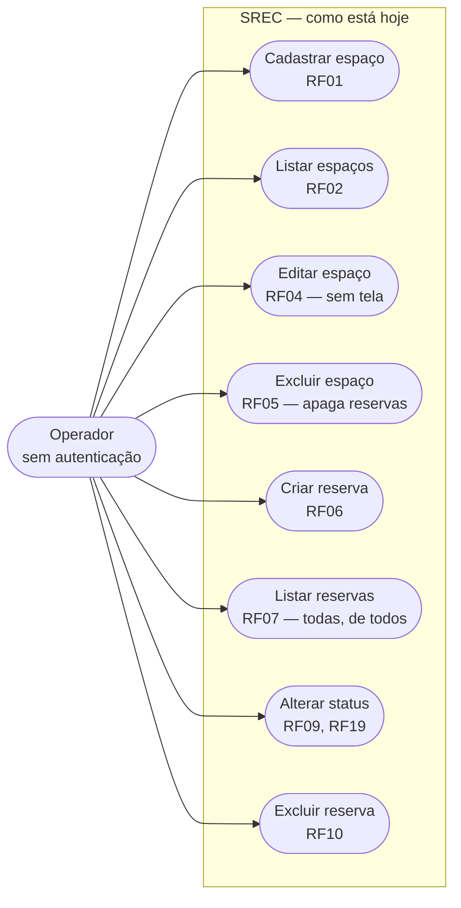

# Requisitos do SREC — reconstruídos por engenharia reversa

Este documento **não** descreve o sistema que gostaríamos de ter. Descreve o
sistema que o grupo da N2 recebeu, derivado linha a linha do código em
`server/src/` e `client/src/`.

A documentação recebida do grupo anterior (`Documentação Oficial SREC.md`) é
preservada no repositório como registro histórico e **não é fonte de verdade**.
Onde ela divergir do código, o código vence. As 12 divergências estão
catalogadas em
[`docs/auditoria/divergencias-doc-codigo.md`](../auditoria/divergencias-doc-codigo.md).

As evidências apontam para o código da `main` **depois** da refatoração do
frontend (FE-01, PR #35, e FE-04, PR #36). O backend está como foi recebido.
Quando um requisito já mudou de situação por um PR da N2, isso aparece no
campo **Corrigido na N2**, com a situação original preservada para o relatório
de antes e depois.

## Como ler este documento

Cada requisito tem:

* **Identificador** — `RFnn` (funcional) ou `RNFnn` (não funcional).
* **História** — `Como <ator>, quero <ação>, para <benefício>`.
* **Situação** — um de quatro valores, e nada além deles:
  * `implementado` — o código faz o que está escrito e os critérios passam.
  * `implementado com defeito (BUG-nn)` ou `(CS-nn)` — existe, com defeito
    catalogado na auditoria.
  * `documentado mas inexistente` — a doc recebida promete; não há código.
  * `não implementado` — não existe e a doc recebida também não prometia.
* **Evidência** — arquivo e linha que sustentam a situação declarada.
* **Critérios de aceitação** — verificáveis, no formato que QA-01 a QA-04
  convertem em teste automatizado.
* **Trabalho na N2** — qual spec mexe nisso, ou `nenhum (débito da N3)`.

Requisito com `Situação` diferente de `implementado` **não** é promessa de
entrega. Entrega é o que está em [`docs/specs/`](../specs/README.md).

## Atores

| Ator | Existe no código? | Observação |
|---|---|---|
| **Operador** | sim | Qualquer pessoa com acesso à URL. Não há login, sessão, token ou cabeçalho de identificação. Tem poder total sobre recursos e reservas. É o único ator real do sistema. Evidência: `server/src/index.js:13-14` registra só `cors()` e `express.json()`; nenhuma rota tem middleware de autenticação (`server/src/routes/resourceRoutes.js:5-9`, `server/src/routes/reservationRoutes.js:5-9`). |
| **Administrador** | não | A doc recebida o declara em `Documentação Oficial SREC.md:39`, amarra a ele o CRUD de espaços (`:52`) e marca `POST /api/resources` como "Nível de acesso Admin" (`:109`). Não há uma linha de autorização no código. Ver RF14. |
| **Usuário identificado** | não | A doc recebida declara `reservations.user_id UUID` (`:94`) e afirma que `GET /api/reservations` lista "as reservas do usuário atual" (`:116`). O schema tem `user_name VARCHAR(100)` preenchido por digitação livre (`server/src/config/initDb.js:17`, `client/src/features/reservations/ReservationForm.jsx:60-71`). Ver RF13. |

Enquanto só existir o ator `Operador`, **todo requisito de visibilidade,
propriedade ou permissão é vácuo**. Isso não é opinião: é o que explica RF13 e
RF14 serem `documentado mas inexistente`.

## Requisitos funcionais

### RF01 — Cadastrar recurso

**História.** Como Operador, quero cadastrar uma estação de trabalho ou sala de
reunião informando nome, tipo e capacidade, para que ela possa ser reservada.

**Situação.** `implementado com defeito (BUG-09)`

**Evidência.** `POST /api/resources` em
`server/src/routes/resourceRoutes.js:5` → `ResourceController.createResource`
(`server/src/controllers/resourceController.js:4-16`) →
`ResourceModel.create` (`server/src/models/resourceModel.js:4-12`). O
formulário está em `client/src/features/resources/ResourceForm.jsx:31-75`, e o
corpo é montado em `client/src/hooks/useResources.js:17-25`.

**Critérios de aceitação.**

1. `POST /api/resources` com `{ "name": "Sala Alpha", "type": "meeting_room", "capacity": 8 }`
   responde `201` e o corpo contém `id`, `name`, `type`, `capacity`,
   `created_at`, `updated_at` — porque o `INSERT` usa `RETURNING *`
   (`server/src/models/resourceModel.js:8`).
2. `POST /api/resources` sem `name` **ou** sem `type` responde `400` com
   `{"error":"Name and type are required"}` — `resourceController.js:7-9`.
3. `POST /api/resources` sem `capacity` responde `201` com `capacity: 1` —
   `resourceController.js:10` passa `capacity || 1`.
4. **Falha hoje (BUG-09):** `POST` com `capacity: 0` deveria responder `400`;
   hoje responde `201` com `capacity: 1`, porque `0 || 1 === 1` em
   `resourceController.js:10`. O dado do Operador é silenciosamente trocado.
5. **Falha hoje (BUG-09):** `POST` com `capacity: -5` deveria responder `400`;
   hoje responde `201` e grava `-5`, porque `-5` é *truthy* e o schema não tem
   `CHECK` (`server/src/config/initDb.js:9`). O `min="1"` do campo
   (`ResourceForm.jsx:63`) só protege quem usa a tela.

**Trabalho na N2.** BE-02 (validação de entrada e `CHECK` no schema).

---

### RF02 — Listar recursos

**História.** Como Operador, quero ver a lista de todos os espaços
cadastrados com tipo e capacidade, para escolher onde reservar.

**Situação.** `implementado`

**Evidência.** `GET /api/resources` em
`server/src/routes/resourceRoutes.js:6` → `getAllResources`
(`resourceController.js:18-26`) → `SELECT * FROM resources ORDER BY id ASC`
(`resourceModel.js:15`). Renderizado em
`client/src/features/resources/ResourceList.jsx:5-20`.

**Critérios de aceitação.**

1. `GET /api/resources` responde `200` com um array JSON, ordenado por `id`
   crescente — `resourceModel.js:15`.
2. Com a tabela vazia, responde `200` com `[]` (não `404`), e o cliente exibe
   "Nenhum espaço cadastrado ainda." — `ResourceList.jsx:11`.
3. A resposta inclui todas as colunas da tabela, inclusive `created_at` e
   `updated_at`, porque a consulta é `SELECT *`.

**Nota de divergência.** A doc recebida descreve este endpoint como "Lista
todos os espaços **disponíveis**" (`Documentação Oficial SREC.md:108`). Ele
lista **todos**, sem qualquer filtro: não há `WHERE`, não há `is_active` (ver
RF15) e não há cruzamento com reservas. A palavra "disponíveis" é falsa.

**Trabalho na N2.** nenhum no comportamento; REQ-03 corrige a descrição no
contrato `docs/arquitetura/openapi.yaml`.

---

### RF03 — Consultar um recurso por identificador

**História.** Como Operador, quero consultar um espaço específico pelo seu
identificador, para ver seus dados isoladamente.

**Situação.** `implementado com defeito (BUG-04)`

**Evidência.** `GET /api/resources/:id` em
`server/src/routes/resourceRoutes.js:7` → `getResourceById`
(`resourceController.js:28-40`) → `SELECT * FROM resources WHERE id = $1`
(`resourceModel.js:21`).

**Critérios de aceitação.**

1. `GET /api/resources/1` com o recurso 1 existente responde `200` com o
   objeto.
2. `GET /api/resources/99999` responde `404` com
   `{"error":"Resource not found"}` — `resourceController.js:32-34`.
3. **Falha hoje (BUG-04):** `GET /api/resources/abc` deveria responder `400`;
   hoje responde `500`. O Postgres levanta `22P02 invalid input syntax for
   type integer: "abc"` dentro do `await`, e o `catch` de
   `resourceController.js:36-39` transforma tudo em
   `{"error":"Internal server error"}`. O mesmo vale para as seis rotas com
   `:id`.

**Nota de cobertura de interface.** Nenhuma tela chama este endpoint: não
existe função correspondente em `client/src/services/api.js` (as 8 funções
estão nas linhas `:5`, `:11`, `:24`, `:37`, `:46`, `:52`, `:65`, `:75`). É
alcançável apenas por cliente HTTP direto. Isso **não** é defeito do endpoint;
é escopo de produto não entregue.

**Trabalho na N2.** BE-04 (formato de erro central) e BE-05 (`400` para `:id`
inválido).

---

### RF04 — Atualizar um recurso

**História.** Como Operador, quero corrigir nome, tipo ou capacidade de um
espaço já cadastrado, para manter o cadastro fiel à realidade física.

**Situação.** `implementado com defeito (BUG-05)`

**Evidência.** `PUT /api/resources/:id` em
`server/src/routes/resourceRoutes.js:8` → `updateResource`
(`resourceController.js:42-55`) → `ResourceModel.update`
(`resourceModel.js:26-35`).

**Critérios de aceitação.**

1. `PUT /api/resources/1` com `{ "name": "Alpha", "type": "meeting_room", "capacity": 10 }`
   responde `200` com o objeto atualizado e `updated_at` renovado —
   `resourceModel.js:29` faz `updated_at = CURRENT_TIMESTAMP`.
2. `PUT /api/resources/99999` com corpo completo responde `404` —
   `resourceController.js:47-49`.
3. **Falha hoje (BUG-05):** `PUT /api/resources/1` com corpo parcial
   `{ "capacity": 4 }` deveria responder `400` exigindo o corpo completo.
   Hoje responde `500`: o controller desestrutura `name` e `type` como
   `undefined` (`resourceController.js:45`), o driver `pg` converte
   `undefined` em `NULL`, e o `UPDATE` de `resourceModel.js:29` viola
   `name VARCHAR(100) NOT NULL` (`initDb.js:7`). O erro é engolido pelo
   `catch` (`resourceController.js:51-54`).
4. **Falha hoje (BUG-15):** nenhuma tela chama este endpoint. A função
   `api.updateResource` existe em `client/src/services/api.js:24-35`, mas o
   hook `client/src/hooks/useResources.js:29` expõe só `createResource` e
   `removeResource`. É funcionalidade paga e não entregue.

**Trabalho na N2.** BE-05 (semântica de `PUT` com corpo completo e `400`),
FE-05 (expor a edição na interface).

---

### RF05 — Excluir um recurso

**História.** Como Operador, quero remover um espaço do cadastro, para que ele
deixe de aparecer como reservável.

**Situação.** `implementado com defeito (BUG-06)`

**Evidência.** `DELETE /api/resources/:id` em
`server/src/routes/resourceRoutes.js:9` → `deleteResource`
(`resourceController.js:57-69`) →
`DELETE FROM resources WHERE id = $1 RETURNING *` (`resourceModel.js:38`).
Botão em `client/src/features/resources/ResourceListItem.jsx:15`, com
`window.confirm` em `client/src/features/resources/ResourcesPanel.jsx:7`.

**Critérios de aceitação.**

1. `DELETE /api/resources/1` responde `200` com
   `{"message":"Resource deleted successfully"}` — `resourceController.js:64`.
2. `DELETE /api/resources/99999` responde `404` —
   `resourceController.js:61-63`.
3. **Falha hoje (BUG-06):** excluir um recurso que possui reservas deveria ser
   bloqueado (`409`) ou pedir confirmação explícita da perda. Hoje apaga em
   silêncio **todas** as reservas daquele recurso, porque
   `server/src/config/initDb.js:16` declara
   `resource_id INTEGER REFERENCES resources(id) ON DELETE CASCADE`. O
   histórico desaparece sem aviso e sem registro. O texto do
   `window.confirm` — "Deseja realmente remover este espaço?"
   (`ResourcesPanel.jsx:7`) — não menciona a perda de reservas.

**Trabalho na N2.** FE-05 (aviso de cascata na interface, mitigação parcial) e
a migration `change-reservation-fk-to-restrict` prevista em OPS-02 (troca de
`CASCADE` por `RESTRICT`). Se a migration não entrar na N2, vira débito
explícito no handoff (REQ-04).

---

### RF06 — Criar reserva sem sobreposição de horário

**História.** Como Operador, quero reservar um espaço informando responsável,
início e fim, para garantir uso exclusivo naquele intervalo.

**Situação.** `implementado com defeito (BUG-01)`

Este é o requisito central do produto. BUG-02, BUG-07, BUG-08 e BUG-13
também incidem sobre ele e estão nos critérios abaixo.

**Evidência.** `POST /api/reservations` em
`server/src/routes/reservationRoutes.js:5` → `createReservation`
(`server/src/controllers/reservationController.js:4-34`), que chama
`ReservationModel.checkAvailability` (`reservationModel.js:49-61`) e, se
disponível, `ReservationModel.create` (`reservationModel.js:4-12`). Formulário
em `client/src/features/reservations/ReservationForm.jsx:41-99`.

A fórmula anti-sobreposição documentada em
`Documentação Oficial SREC.md:72` —
`Início_banco < Fim_novo AND Fim_banco > Início_novo` — **confere** com a
implementada em `reservationModel.js:55`:
`(start_time < $3 AND end_time > $2)`, com `$2 = start_time` novo e
`$3 = end_time` novo (parâmetros em `reservationModel.js:59`). A fórmula está
certa. O problema está em executá-la fora de transação e sem constraint.

**Critérios de aceitação.**

1. `POST /api/reservations` com
   `{ "resource_id": 1, "user_name": "Carlos", "start_time": "2026-11-03T09:00", "end_time": "2026-11-03T10:00" }`
   em recurso livre responde `201`, e o corpo traz `status: "scheduled"` por
   default do schema (`initDb.js:20`).
2. Faltando qualquer um dos quatro campos, responde `400` com
   `{"error":"All fields are required"}` — `reservationController.js:7-9`.
3. Sobreposição parcial com reserva existente responde `409` com
   `{"error":"Resource is not available for the selected time slot"}` —
   `reservationController.js:17-21`.
4. Reserva encostada (`end_time` de uma igual ao `start_time` da outra) é
   aceita com `201`, porque a comparação é estritamente `<` e `>`
   (`reservationModel.js:55`). Comportamento correto e intencional.
5. Reserva cujo conflito está com uma reserva `cancelled` é aceita, porque a
   consulta filtra `status != 'cancelled'` (`reservationModel.js:53`).
6. **Falha hoje (BUG-01):** duas requisições concorrentes para o mesmo
   intervalo deveriam resultar em uma `201` e uma `409`. Hoje as duas podem
   responder `201`. Entre a leitura em `reservationController.js:12-16` e a
   escrita em `:23-28` não há transação, nem `SELECT ... FOR UPDATE`, nem
   constraint no banco (`initDb.js:14-23` não tem `EXCLUDE`). É a janela
   TOCTOU clássica. **Teste que falha antes da correção:** disparar 10
   `POST` simultâneos com o mesmo intervalo e exigir exatamente 1 `201`.
7. **Falha hoje (BUG-02):** `end_time` anterior a `start_time` deveria
   responder `400`. Hoje responde `201`, e pior: a reserva invertida **nunca
   colide com nada**, porque `start_time < $3 AND end_time > $2` é
   insatisfazível quando o intervalo é vazio. O dado corrompido fica invisível
   à regra central. Não há validação no controller
   (`reservationController.js:7` só checa presença) nem `CHECK` no schema.
8. **Falha hoje (BUG-08):** reserva inteiramente no passado deveria responder
   `400`. Hoje é aceita com `201`; não há comparação com `NOW()` em nenhum
   ponto de `reservationController.js`.
9. **Falha hoje (BUG-07):** o horário gravado deve ser o horário que o
   Operador digitou. Ver RNF04.
10. **Falha hoje (BUG-13):** um duplo clique em "Confirmar Reserva" deveria
    gerar uma única requisição. O botão de envio
    (`ReservationForm.jsx:94-96`) não é desabilitado durante o envio.

**Trabalho na N2.** BE-01 (constraint `EXCLUDE` e transação), BE-02
(`CHECK` de janela e validação de entrada), BE-07 (`TIMESTAMPTZ`), FE-02
(envio do horário com offset), FE-03 (trava de envio).

---

### RF07 — Listar reservas

**História.** Como Operador, quero ver todas as reservas registradas em ordem
cronológica, para acompanhar a ocupação dos espaços.

**Situação.** `implementado`

**Evidência.** `GET /api/reservations` em
`server/src/routes/reservationRoutes.js:6` → `getAllReservations`
(`reservationController.js:36-44`) →
`SELECT * FROM reservations ORDER BY start_time ASC`
(`reservationModel.js:15`). Renderizado em
`client/src/features/reservations/ReservationList.jsx:5-29`.

**Critérios de aceitação.**

1. Responde `200` com array ordenado por `start_time` crescente.
2. Retorna reservas de **todos** os responsáveis e em **todos** os status,
   inclusive `cancelled` — não há `WHERE` na consulta.
3. Com a tabela vazia, responde `200` com `[]`, e o cliente exibe "Nenhuma
   reserva registrada." — `ReservationList.jsx:14`.

**Nota de divergência.** A doc recebida descreve este endpoint como "Lista as
reservas **do usuário atual**" (`Documentação Oficial SREC.md:116`). Não
existe usuário atual — ver RF13. A descrição é falsa e é corrigida no contrato
por REQ-03.

**Trabalho na N2.** a listagem não muda; a ausência de índice sobre
`resource_id` e `start_time` (CS-09) é tratada em OPS-02.

---

### RF08 — Consultar uma reserva por identificador

**História.** Como Operador, quero consultar uma reserva específica pelo seu
identificador, para ver seus dados isoladamente.

**Situação.** `implementado com defeito (BUG-04)`

**Evidência.** `GET /api/reservations/:id` em
`server/src/routes/reservationRoutes.js:7` → `getReservationById`
(`reservationController.js:46-58`) → `SELECT * FROM reservations WHERE id = $1`
(`reservationModel.js:20-24`). Sem função correspondente em
`client/src/services/api.js` — alcançável só por cliente HTTP direto.

**Critérios de aceitação.**

1. `GET /api/reservations/1` com a reserva 1 existente responde `200` com o
   objeto.
2. `GET /api/reservations/99999` responde `404` com
   `{"error":"Reservation not found"}` — `reservationController.js:50-52`.
3. **Falha hoje (BUG-04):** `GET /api/reservations/abc` deveria responder
   `400`; hoje responde `500` pelo mesmo mecanismo de RF03 — o `22P02` do
   Postgres cai no `catch` de `reservationController.js:54-57`.

**Trabalho na N2.** BE-04 e BE-05.

---

### RF09 — Alterar o status de uma reserva

**História.** Como Operador, quero mudar o status de uma reserva, para
registrar que ela foi concluída ou cancelada.

**Situação.** `implementado com defeito (BUG-03)`

**Evidência.** `PATCH /api/reservations/:id/status` em
`server/src/routes/reservationRoutes.js:8` → `updateReservationStatus`
(`reservationController.js:60-73`) → `ReservationModel.updateStatus`
(`reservationModel.js:32-41`). Acionado em
`client/src/features/reservations/ReservationListItem.jsx:26` (`completed`)
e `:32` (`cancelled`).

**Critérios de aceitação.**

1. `PATCH /api/reservations/1/status` com `{"status":"cancelled"}` responde
   `200` com o objeto e `updated_at` renovado — `reservationModel.js:35`.
2. O mesmo `PATCH` para `{id}` inexistente responde `404` —
   `reservationController.js:65-67`.
3. **Falha hoje (BUG-03):** `{"status":"banana"}` deveria responder `400`.
   Hoje grava `banana` e responde `200`. Não há `CHECK` no schema
   (`initDb.js:20`) nem verificação em `reservationController.js:60-64`.
4. **Falha hoje (BUG-03):** requisição **sem** `status` no corpo deveria
   responder `400`. Hoje `req.body.status` é `undefined`, o driver `pg`
   converte em `NULL`, e o `status` fica nulo. A partir daí a reserva
   **desaparece da regra anti-sobreposição**: em `reservationModel.js:53`,
   `NULL != 'cancelled'` avalia para `NULL`, que não satisfaz o `WHERE`. Uma
   reserva com status nulo deixa de bloquear qualquer horário — BUG-03 é, na
   prática, um caminho para corromper RF06.
5. **Falha hoje (BUG-03):** transição a partir de estado terminal
   (`completed` → `scheduled`, `cancelled` → `scheduled`) deveria responder
   `409`. Hoje é aceita; a API não conhece ciclo de vida (ver RF19).

**Trabalho na N2.** BE-03 (`CHECK` de status, transições válidas e validação
no controller).

---

### RF10 — Excluir uma reserva definitivamente

**História.** Como Operador, quero apagar uma reserva do sistema, para remover
um registro feito por engano.

**Situação.** `implementado`

**Evidência.** `DELETE /api/reservations/:id` em
`server/src/routes/reservationRoutes.js:9` → `deleteReservation`
(`reservationController.js:75-87`) → `reservationModel.js:43-47`. Botão em
`client/src/features/reservations/ReservationListItem.jsx:38-43`, com
`window.confirm` em `client/src/features/reservations/ReservationsPanel.jsx:22`.

**Critérios de aceitação.**

1. `DELETE /api/reservations/1` responde `200` com
   `{"message":"Reservation deleted successfully"}` —
   `reservationController.js:82`.
2. `DELETE /api/reservations/99999` responde `404` —
   `reservationController.js:79-81`.
3. Depois da exclusão, `GET /api/reservations/1` responde `404` — a remoção é
   física (`reservationModel.js:44`), não lógica.

**Ambiguidade de produto a registrar.** A exclusão física coexiste com o
cancelamento por status (RF09), e a interface mistura os dois: o
`window.confirm` do botão de exclusão diz "Deseja **cancelar** esta reserva
permanentemente?" (`ReservationsPanel.jsx:22`), o rótulo do botão diz
"Excluir definitivamente" (`ReservationListItem.jsx:39`) e o feedback diz
"Reserva removida!" (`ReservationsPanel.jsx:23`). Três vocabulários para uma
ação. Não é bug de código; é débito de produto, registrado no handoff (REQ-04).

**Trabalho na N2.** nenhum no comportamento.

---

### RF11 — Cancelar reserva por rota dedicada

**História.** Como Operador, quero cancelar uma reserva por uma rota de
cancelamento dedicada, para que a intenção "cancelar" seja explícita no
contrato da API.

**Situação.** `documentado mas inexistente`

**Evidência.** A doc recebida lista
`PUT /api/reservations/{id}/cancel` — "Cancela uma reserva existente"
(`Documentação Oficial SREC.md:117`). O arquivo de rotas
`server/src/routes/reservationRoutes.js` tem exatamente cinco registros
(linhas `5` a `9`) e **nenhum** deles é `PUT`, nem contém o segmento
`cancel`. A chamada `PUT /api/reservations/1/cancel` cai no handler padrão do
Express 5 e responde `404`.

O cancelamento **existe**, por outro caminho: `PATCH
/api/reservations/:id/status` com `{"status":"cancelled"}`, que é o que o
cliente faz em `client/src/features/reservations/ReservationListItem.jsx:32`.

**Critérios de aceitação (se um dia for implementado).**

1. `PUT /api/reservations/{id}/cancel` em reserva `scheduled` responde `200`
   com `status: "cancelled"`.
2. A mesma chamada em reserva já `cancelled` responde `409`.
3. A mesma chamada em `{id}` inexistente responde `404`.

**Decisão da N2.** **Não implementar.** O cancelamento já é alcançável por
`PATCH /:id/status`, que será endurecido por BE-03. Criar um segundo caminho
para o mesmo efeito aumentaria a superfície da API sem benefício para o
usuário, e a rubrica da N2 premia melhoria comprovada do código recebido, não
novas rotas. A resolução adotada é **corrigir a documentação**: o contrato da
API (REQ-03) documenta `PATCH /:id/status` como o único caminho de transição
de status, e o handoff (REQ-04) registra a rota `/cancel` como ficção herdada,
já descartada, para que a N3 não a procure.

---

### RF12 — Listar as reservas de um recurso específico

**História.** Como Operador, quero ver a agenda de um espaço específico, para
avaliar sua ocupação antes de reservar.

**Situação.** `não implementado`

**Evidência.** A capacidade **existe no model e não está exposta**:
`ReservationModel.findByResourceId` em
`server/src/models/reservationModel.js:26-30` executa
`SELECT * FROM reservations WHERE resource_id = $1 ORDER BY start_time ASC`.
Nenhum controller a chama (`grep findByResourceId server/src/controllers/`
não retorna nada) e nenhuma rota a expõe. É código morto escrito e nunca
ligado.

A doc recebida também não promete este endpoint
(`Documentação Oficial SREC.md:106-117` lista cinco, nenhum por recurso) — por
isso `não implementado` e não `documentado mas inexistente`.

**Critérios de aceitação (se um dia for implementado).**

1. `GET /api/resources/{id}/reservations` responde `200` com as reservas
   daquele recurso, ordenadas por `start_time`.
2. Para recurso existente sem reservas, responde `200` com `[]`.
3. Para recurso inexistente, responde `404`.

**Trabalho na N2.** nenhum. É a evolução mais barata para a N3 e fica marcada
como tal no handoff (REQ-04): o model já existe, basta controller, rota e
teste.

---

### RF13 — Identificar quem fez a reserva

**História.** Como Operador, quero que a reserva esteja vinculada a um usuário
identificado do sistema, para que seja possível saber de quem é a reserva e
listar "minhas reservas".

**Situação.** `documentado mas inexistente`

**Evidência.** A doc recebida declara `UUID user_id` na entidade
`RESERVATION` (`Documentação Oficial SREC.md:94`) e afirma que
`GET /api/reservations` lista "as reservas do usuário atual" (`:116`). O que
existe:

* `server/src/config/initDb.js:17` — `user_name VARCHAR(100) NOT NULL`, texto
  livre. Não há tabela `users`, não há FK, não há unicidade.
* `client/src/features/reservations/ReservationForm.jsx:60-71` — um
  `<input type="text">` com placeholder "Ex: Carlos Silva". O Operador digita
  o nome que quiser; dois Operadores podem digitar `"Carlos"` e o sistema os
  trata como a mesma string sem tratá-los como a mesma pessoa.
* `server/src/models/reservationModel.js:15` — `findAll` sem `WHERE`: não há
  nem filtro por `user_name`, muito menos por usuário autenticado.

**Critérios de aceitação (se um dia for implementado).**

1. Existe entidade de usuário persistida com identificador estável.
2. `reservations` referencia essa entidade por chave estrangeira.
3. `GET /api/reservations` filtra pelo usuário da sessão.
4. Um usuário não consegue alterar nem excluir reserva de outro.

**Decisão da N2.** **Não implementar.** Introduzir identidade de usuário
implica tabela nova, autenticação, sessão, migração do dado existente de
`user_name` e reescrita das telas — ou seja, nova funcionalidade complexa, que
é o escopo da N3 ("evoluir novas funcionalidades complexas"), não da N2.
Resolução: **corrigir a documentação** (o DER real, em REQ-02, mostra
`user_name VARCHAR(100)`, sem `user_id`) e **registrar como débito
priorizado** no handoff (REQ-04). O que a N2 faz é deixar o terreno pronto:
com `CHECK` de status (BE-03) e constraint `EXCLUDE` (BE-01) no banco,
acrescentar uma coluna `user_id` depois não exige rediscutir a regra de
integridade central.

---

### RF14 — Restringir a gestão de espaços a administradores

**História.** Como Administrador, quero ser o único capaz de cadastrar,
alterar e excluir espaços, para que operadores comuns não alterem o cadastro
físico do coworking.

**Situação.** `documentado mas inexistente`

**Evidência.** A doc recebida marca `POST /api/resources` como "Cadastra um
novo espaço - **Nível de acesso Admin**"
(`Documentação Oficial SREC.md:109`) e, no diagrama de casos de uso, liga
`UC4 (Gerenciar Espaços - CRUD)` exclusivamente ao ator `admin` (`:45`,
`:52`). O que existe:

* `server/src/index.js:13-14` — a cadeia de middlewares é `cors()` e
  `express.json()`. Nada mais. E `cors()` sem argumento libera **qualquer**
  origem (CS-14).
* `server/src/routes/resourceRoutes.js:5-9` — os cinco `router.<verbo>`
  passam direto para o controller, sem middleware intermediário.
* `server/src/controllers/resourceController.js` — nenhuma leitura de
  `req.headers.authorization`, nenhum `req.user`, 72 linhas sem uma linha de
  autorização.
* `server/package.json:18-23` — as dependências de produção são `cors`,
  `dotenv`, `express` e `pg`. Não há `jsonwebtoken`, `passport`, `bcrypt` nem
  equivalente. Não existe nem o material para fazer autenticação.

Qualquer pessoa na rede executa
`curl -X DELETE http://localhost:5000/api/resources/1` e apaga um espaço —
junto com todas as reservas dele, por RF05/BUG-06.

**Critérios de aceitação (se um dia for implementado).**

1. `POST`, `PUT` e `DELETE` em `/api/resources` sem credencial respondem
   `401`.
2. Com credencial de operador comum, respondem `403`.
3. Com credencial de administrador, respondem `201`/`200`.
4. `GET /api/resources` segue público, ou passa a exigir sessão — decisão de
   produto a tomar junto.

**Decisão da N2.** **Não implementar.** Autenticação e autorização são
funcionalidade nova e dependem de RF13 (não há a quem atribuir papel sem
usuário). A N2 corrige o código recebido e **declara a lacuna**; não inventa
um módulo de segurança em uma semana sem requisito de negócio validado.
Resolução: **corrigir a documentação** (remover "Nível de acesso Admin" do
contrato em REQ-03 e o ator `Administrador` dos casos de uso em REQ-02) e
**registrar como débito de severidade alta** no handoff (REQ-04). A parte de
CS-14 que não depende de identidade (`cors()` aberto, sem `helmet`, sem
*rate limit*) é tratada em BE-08 — ver RNF07.

---

### RF15 — Ativar e inativar um espaço

**História.** Como Operador, quero marcar um espaço como inativo sem excluí-lo,
para tirá-lo de circulação durante manutenção preservando o histórico de
reservas.

**Situação.** `documentado mas inexistente`

**Evidência.** A doc recebida declara `BOOLEAN is_active` na entidade
`RESOURCE` (`Documentação Oficial SREC.md:88`). A coluna **não existe**: o
`CREATE TABLE resources` em `server/src/config/initDb.js:5-12` tem exatamente
`id`, `name`, `type`, `capacity`, `created_at`, `updated_at`. Consequências em
cascata:

* `ResourceModel` não a lê nem escreve: `create` insere três colunas
  (`resourceModel.js:6`), `update` atualiza três (`resourceModel.js:29`).
* `GET /api/resources` não pode filtrar por ela — o que explica por que a
  descrição "lista todos os espaços **disponíveis**"
  (`Documentação Oficial SREC.md:108`) é falsa (ver RF02).
* A única forma de tirar um espaço de circulação hoje é `DELETE`, que apaga o
  histórico de reservas por `ON DELETE CASCADE` (RF05/BUG-06). A ausência de
  `is_active` **transforma uma inativação temporária em perda de dado
  permanente**.

**Critérios de aceitação (se um dia for implementado).**

1. `resources` tem `is_active BOOLEAN NOT NULL DEFAULT TRUE`.
2. `GET /api/resources?active=true` retorna só os ativos.
3. `POST /api/reservations` para recurso inativo responde `409`.
4. Reservas já existentes de um recurso inativado permanecem consultáveis.

**Decisão da N2.** **Não implementar na N2.** A coluna é barata; o que não é
barato é a cadeia que ela puxa — filtro na listagem, bloqueio na criação de
reserva, tela de alternância, migração. Além disso, a decisão correta sobre
RF05/BUG-06 (trocar `CASCADE` por `RESTRICT`) muda o desenho de `is_active`:
com `RESTRICT`, a inativação deixa de ser paliativo para exclusão e passa a
ser estado de produto legítimo. Fazer as duas na ordem errada custa retrabalho.
Resolução: **corrigir a documentação** (o DER real, em REQ-02, não tem
`is_active`) e **registrar como a evolução de melhor relação custo-benefício
para a N3** no handoff (REQ-04).

---

### RF16 — Visualizar disponibilidade dos espaços

**História.** Como Operador, quero ver a ocupação atualizada dos espaços, para
saber o que está livre antes de tentar reservar.

**Situação.** `implementado com defeito (CS-08)`

**Evidência.** A doc recebida promete "feedback dinâmico e em tempo real sobre
a disponibilidade das salas" (`Documentação Oficial SREC.md:127`). O que
existe é a aba "Agendamentos" listando reservas
(`client/src/features/reservations/ReservationList.jsx:5-29`), recarregada por
`reloadAll` (`client/src/hooks/useAppData.js:20-26`) depois de **toda**
mutação bem-sucedida (`client/src/App.jsx:20-23`). Não há endpoint de
disponibilidade, não há polling, não há WebSocket. "Tempo real" significa, na
prática, "recarrega tudo depois que você clica". A disponibilidade só é
avaliada no instante do `POST`, dentro de `checkAvailability`
(`reservationModel.js:49-61`).

**Critérios de aceitação.**

1. Depois de criar, alterar ou excluir um espaço ou uma reserva, a lista
   exibida reflete o novo estado sem recarregar a página — atendido hoje.
2. Uma reserva criada por **outro** Operador aparece sem ação do usuário
   atual — **não atendido**: não há polling nem push.
3. Uma mutação recarrega só a lista afetada, e não as duas — **não atendido**
   (CS-08): `useAppData.js:22` dispara `loadResources` e `loadReservations`
   juntos.

**Trabalho na N2.** nenhum (débito da N3). FE-01 preservou o CS-08 de
propósito (`useAppData.js:19`) para não mudar comportamento numa refatoração
estrutural.

---

### RF17 — Navegar entre espaços e agendamentos por abas

**História.** Como Operador, quero alternar entre a gestão de espaços e a de
agendamentos, para trabalhar em uma coisa de cada vez.

**Situação.** `implementado`

**Evidência.** As duas abas estão declaradas em `client/src/App.jsx:10-13`,
o estado `activeTab` em `App.jsx:16`, os botões em
`client/src/components/Tabs.jsx:3-14` e os dois painéis condicionais em
`App.jsx:32-51`.

**Critérios de aceitação.**

1. Ao abrir a aplicação, a aba "Espaços e Salas" está ativa — valor inicial
   `'resources'` em `App.jsx:16`.
2. Clicar em "Agendamentos" exibe o painel de reservas e oculta o de espaços.
3. A aba ativa recebe a classe `active` — `Tabs.jsx:8`.

**Trabalho na N2.** nenhum.

---

### RF18 — Receber retorno visual do resultado de cada operação

**História.** Como Operador, quero ver uma mensagem de sucesso ou erro depois
de cada ação, para saber se ela funcionou.

**Situação.** `implementado`

**Evidência.** `showFeedback` em `client/src/hooks/useFeedback.js:16-28`
grava a mensagem e agenda a limpeza em 4 s (`FEEDBACK_TIMEOUT_MS`, `:3`). O
timer fica em `useRef` (`:7`), é cancelado antes de cada nova mensagem
(`:20`) e no desmonte (`:37`). A mensagem é exibida por
`client/src/components/Alert.jsx:3-13`, com `role="alert"` e
`aria-live="assertive"`, a partir de `client/src/App.jsx:30`.

**Critérios de aceitação.**

1. Toda criação, alteração ou exclusão bem-sucedida exibe mensagem de sucesso.
2. Toda falha exibe a mensagem de erro devolvida pela API.
3. A mensagem some sozinha depois de 4 s.
4. Duas mensagens seguidas: a segunda fica visível os 4 s inteiros.
5. Desmontar o componente com mensagem na tela não dispara `setState` em
   componente desmontado.

Os critérios 4 e 5 são cobertos por `client/src/hooks/useFeedback.test.js`.

**Corrigido na N2.** FE-04 (PR #36). Situação no código recebido:
`implementado com defeito (BUG-14)` — o retorno do `setTimeout` nunca era
guardado nem limpo.

---

### RF19 — Concluir uma reserva realizada

**História.** Como Operador, quero marcar uma reserva agendada como concluída,
para registrar que o espaço foi de fato usado.

**Situação.** `implementado com defeito (BUG-03)`

**Evidência.** `client/src/features/reservations/ReservationListItem.jsx:23-29`
chama `onChangeStatus(reservation.id, RESERVATION_STATUS.COMPLETED)`, que usa
o mesmo `PATCH /:id/status` de RF09. Os botões de concluir e cancelar só
aparecem se `reservation.status === RESERVATION_STATUS.SCHEDULED`
(`ReservationListItem.jsx:21`), o que implementa o ciclo de vida
`scheduled → completed | cancelled` descrito em
`Documentação Oficial SREC.md:32` — mas **somente na interface**. A API aceita
qualquer transição, de qualquer estado para qualquer string (BUG-03).

**Critérios de aceitação.**

1. Reserva `scheduled` exibe os botões "Concluir" e "Cancelar"; reserva
   `completed` ou `cancelled` não exibe — atendido na interface.
2. Clicar em "Concluir" muda o status para `completed` e exibe "Status da
   reserva atualizado!" — `ReservationsPanel.jsx:39`.
3. **Falha hoje (BUG-03):** `PATCH` direto na API de `completed` para
   `scheduled` deveria responder `409`; hoje responde `200`.

**Trabalho na N2.** BE-03.

---

## Requisitos não funcionais

### RNF01 — Persistência relacional em PostgreSQL

**História.** Como time de manutenção, quero que recursos e reservas vivam em
PostgreSQL, para que o dado sobreviva a reinícios e seja consultável por SQL.

**Situação.** `implementado`

**Evidência.** `server/src/config/database.js:4-6` cria um `Pool` do `pg` a
partir de `process.env.DATABASE_URL`; `server/package.json:22` fixa
`pg ^8.23.0`; os dois models usam SQL cru parametrizado
(`resourceModel.js`, `reservationModel.js`).

**Critérios de aceitação.**

1. Subindo o servidor com `DATABASE_URL` válida, o log imprime
   `Connected to PostgreSQL Database` — `database.js:8-10`.
2. Toda consulta usa parâmetros posicionais (`$1`, `$2`, ...), nunca
   concatenação de string. Verificável: não há template literal com
   interpolação de variável dentro de string SQL nos dois models.
3. Dado gravado permanece após reiniciar o processo.

**Trabalho na N2.** nenhum.

---

### RNF02 — Evolução do schema por migrations versionadas

**História.** Como time de manutenção, quero que toda mudança de schema seja um
arquivo versionado e aplicável em ordem, para que qualquer ambiente chegue ao
mesmo estado de banco.

**Situação.** `não implementado`

**Evidência.** O schema é efeito colateral do boot (CS-06):
`server/src/index.js:26-31` chama `await initDb()` antes de `app.listen`, e
`server/src/config/initDb.js:4-24` é um único `CREATE TABLE IF NOT EXISTS`
literal. Não existe pasta de migrations no repositório, nenhuma dependência de
migração em `server/package.json:18-33`, e nenhum script `migrate` em
`server/package.json:6-13`.

O efeito prático é grave e precisa estar escrito: por causa do
`IF NOT EXISTS`, **em qualquer banco que já tenha as tabelas, nenhuma alteração
de schema é aplicada**. Acrescentar uma coluna ou constraint editando
`initDb.js` não produz efeito em banco existente — só em banco novo. Essa é a
razão técnica pela qual BE-01, BE-02, BE-03 e BE-07 precisam de migrations de
verdade, e não de edição do `initDb.js`.

**Critérios de aceitação.**

1. Existe um diretório de migrations com arquivos ordenáveis e imutáveis.
2. Há comando único que aplica as migrations pendentes.
3. Rodar o comando duas vezes em sequência não produz erro nem efeito duplo.
4. `initDb.js` deixa de criar schema, ou é removido.

**Trabalho na N2.** OPS-02, que também hospeda as migrations de BE-01, BE-02,
BE-03 e BE-07.

---

### RNF03 — Integridade garantida pelo banco de dados

**História.** Como time de manutenção, quero que as regras invioláveis do
domínio sejam constraints no banco, para que nenhum caminho de código consiga
gravar dado inválido.

**Situação.** `não implementado`

**Evidência.** Contagem direta sobre `server/src/config/initDb.js:4-24`:
**zero** `CHECK`, **zero** `UNIQUE`, **zero** `EXCLUDE`, **zero** índice além
das duas chaves primárias. Em detalhe:

* `type VARCHAR(50) NOT NULL` (`:8`) — o valor permitido está em **comentário**
  (`-- 'workstation' or 'meeting_room'`), não em constraint. Base de BUG-10.
* `capacity INTEGER NOT NULL DEFAULT 1` (`:9`) — aceita `-5`. Base de BUG-09.
* `status VARCHAR(20) DEFAULT 'scheduled'` (`:20`) — os valores válidos também
  estão só em comentário, e a coluna **não é** `NOT NULL`. Base de BUG-03.
* `start_time`/`end_time` (`:18-19`) — nada impede `end_time < start_time`.
  Base de BUG-02.
* `resource_id INTEGER REFERENCES resources(id) ON DELETE CASCADE` (`:16`) —
  **não é** `NOT NULL`: `INSERT` com `resource_id NULL` é aceito pelo banco.
  Hoje o controller barra por acidente, porque `!resource_id` é verdadeiro para
  `null` (`reservationController.js:7`); a integridade depende de uma
  checagem de truthiness no JavaScript, não do schema.
* Nenhuma constraint protege a regra central de não sobreposição. Ela existe
  apenas como `SELECT` em `reservationModel.js:49-61`. Base de BUG-01.

**Critérios de aceitação.**

1. `INSERT` direto por `psql` com `end_time < start_time` é rejeitado pelo
   banco.
2. `INSERT` direto por `psql` com `status = 'banana'` é rejeitado.
3. `INSERT` direto por `psql` com `capacity = 0` é rejeitado.
4. `INSERT` direto por `psql` de duas reservas sobrepostas no mesmo recurso,
   ambas com status diferente de `cancelled`, é rejeitado na segunda.
5. `INSERT` direto por `psql` com `resource_id NULL` é rejeitado.

O critério "direto por `psql`" é deliberado: constraint que só é verificada
pela API não é integridade, é validação. O teste tem de furar a aplicação.

**Trabalho na N2.** BE-01 (`EXCLUDE`), BE-02 (`CHECK` de janela e de
capacidade), BE-03 (`CHECK` de status e de tipo).

---

### RNF04 — Correção de fuso horário nos horários de reserva

**História.** Como Operador, quero que a reserva apareça exatamente no horário
que digitei, para não perder a sala por deslocamento de fuso.

**Situação.** `implementado com defeito (BUG-07)`

**Evidência.** Três pontos que se somam:

1. `server/src/config/initDb.js:18-19` — `start_time TIMESTAMP NOT NULL`,
   `end_time TIMESTAMP NOT NULL`. `TIMESTAMP` sem `WITH TIME ZONE` armazena um
   horário sem fuso: o Postgres guarda os dígitos e descarta qualquer offset
   recebido.
2. `client/src/features/reservations/ReservationForm.jsx:76` e `:87` —
   `<input type="datetime-local">` produz `"2026-11-03T09:00"`, sem offset,
   enviado cru em `ReservationForm.jsx:29-30`.
3. `client/src/features/reservations/ReservationListItem.jsx:15-16` — a
   exibição faz `new Date(reservation.start_time).toLocaleString('pt-BR')`. O
   `pg` devolve o `TIMESTAMP` como `Date` do JavaScript interpretado no fuso
   do processo; o `toLocaleString('pt-BR')` então converte de novo. Em
   UTC-03, o horário exibido difere do digitado.

Os `created_at`/`updated_at` (`initDb.js:10-11`, `:21-22`) sofrem do mesmo
problema, e `CURRENT_TIMESTAMP` em coluna sem fuso perde a informação de
offset do servidor.

**Critérios de aceitação.**

1. Reserva criada com início `2026-11-03T09:00` no fuso `America/Sao_Paulo` é
   exibida como `03/11/2026 09:00`.
2. O mesmo registro, consultado por `psql`, mostra o instante com offset
   explícito.
3. O resultado não muda se o processo Node subir com `TZ=UTC`. Este é o
   critério decisivo: hoje o comportamento depende do fuso da máquina.

**Trabalho na N2.** BE-07 (`TIMESTAMPTZ`), FE-02 (enviar com offset).

---

### RNF05 — Testes automatizados cobrindo as regras de domínio

**História.** Como time de manutenção, quero que as regras de domínio tenham
teste automatizado, para que uma refatoração que as quebre falhe na CI.

**Situação.** `implementado com defeito (CS-03)`

**Evidência.** A doc recebida afirma "testes unitários automatizados de
domínio via Jest" (`Documentação Oficial SREC.md:65`). No backend existe **1**
arquivo de teste com **2** casos, ambos sobre `checkAvailability` e ambos com
o banco *mockado* (`server/src/models/reservationModel.test.js:4`, `:11-37`):
eles provam que a função lê `rows.length`, não que a fórmula SQL detecta
sobreposição. Cobertura medida no baseline: 6,14 % de statements, 0 % de
branches, 0 % nos controllers e nas rotas. Sem camada de serviço (CS-03), a
regra não tem onde ser testada isolada do Express e do banco. O
`supertest` está declarado (`server/package.json:32`) e nunca é importado.

No frontend, FE-01 e FE-04 trouxeram Vitest com 14 casos
(`client/src/App.test.jsx`, `client/src/a11y.test.jsx`,
`client/src/hooks/useFeedback.test.js`). Eles cobrem a interface, não o
domínio.

**Critérios de aceitação.**

1. `npm test` em `server/` exercita cada rota pelo menos uma vez via
   `supertest`.
2. Cada BUG catalogado do backend tem um teste que falhava antes da correção.
3. A regra de sobreposição é testada contra um Postgres real, não contra
   *mock*.
4. A cobertura de statements, medida com `--collectCoverageFrom='src/**/*.js'`,
   sai de 6,14 % para o alvo definido em OPS-03.

**Trabalho na N2.** BE-06 (camada de serviço), QA-01 (integração), QA-02
(regras de domínio).

---

### RNF06 — Resiliência e observabilidade do processo

**História.** Como time de manutenção, quero que o servidor falhe de forma
explícita e se mantenha de pé diante de falhas transitórias do banco, para
diagnosticar problemas sem adivinhar.

**Situação.** `implementado com defeito (BUG-12)`

**Evidência.** `server/src/config/database.js:8-10` registra handler para
`'connect'` e **não** para `'error'`: a queda do Postgres emite `error` não
tratado no `Pool` e derruba o processo (BUG-12). `server/src/config/initDb.js:28-30`
captura falha de criação de tabela e só faz `console.error` — e
`server/src/index.js:26-31` segue para `app.listen`, então o servidor sobe sem
schema (BUG-11). Não há rota `/health` e não há log estruturado: os 10
`catch` só fazem `console.error(err)`.

**Critérios de aceitação.**

1. Com o banco inacessível no boot, o processo encerra com código diferente de
   `0` e mensagem explícita, em vez de escutar a porta.
2. Com o Postgres reiniciado durante a execução, o processo continua vivo e
   volta a responder quando o banco volta.
3. Existe rota de saúde que responde `200` com banco ok e `503` sem banco.

**Trabalho na N2.** BE-08 (BUG-11, BUG-12) e OPS-04 (configuração validada no
boot).

---

### RNF07 — Superfície HTTP segura

**História.** Como time de manutenção, quero que a API restrinja origem,
cabeçalhos e volume de requisições, para que ela não fique aberta a qualquer
site ou script.

**Situação.** `não implementado`

**Evidência.** `server/src/index.js:13` — `app.use(cors())` sem opções libera
qualquer origem. Não há `helmet`, `express-rate-limit` nem limite explícito de
corpo; `server/package.json:18-23` confirma a ausência das dependências.
Nenhuma rota exige credencial (ver RF14). Catalogado como CS-14.

**Critérios de aceitação.**

1. Requisição com `Origin` fora da lista configurada não recebe
   `Access-Control-Allow-Origin`.
2. As respostas trazem os cabeçalhos de segurança padrão (por exemplo
   `X-Content-Type-Options: nosniff`).
3. Rajada acima do limite configurado responde `429`.

**Trabalho na N2.** BE-08 para CORS, cabeçalhos e limite. Autenticação fica
como débito da N3 (RF14).

---

### RNF08 — Contrato de API publicado e versionado

**História.** Como integrador ou grupo da N3, quero um contrato formal da API,
para saber cada rota, corpo, status e erro sem ler o código.

**Situação.** `não implementado`

**Evidência.** Não há OpenAPI, Swagger nem coleção Postman no repositório. A
única descrição da API é a tabela de 5 linhas em
`Documentação Oficial SREC.md:106-117`, que omite 5 dos 10 endpoints reais
(`server/src/routes/resourceRoutes.js:5-9`,
`server/src/routes/reservationRoutes.js:5-9`), descreve 3 errado e inclui 1
que não existe (RF11). A rubrica da N1 já pedia "coleção da API
(Postman/Swagger)".

**Critérios de aceitação.**

1. Existe um único arquivo de contrato OpenAPI no repositório.
2. As operações do contrato são exatamente as 10 rotas do código, verificado
   por script.
3. Cada operação documenta corpo, respostas de sucesso e de erro.

**Trabalho na N2.** REQ-03.

---

### RNF09 — Padronização de estilo por lint e formatador

**História.** Como time de manutenção, quero lint e formatador configurados
nos dois pacotes, para que o estilo não dependa de quem escreveu.

**Situação.** `implementado`

**Evidência.** `server/package.json:9-11` (`lint`, `lint:fix`, `format`),
`client/package.json:9-11` (idem), os `server/eslint.config.js` e
`client/eslint.config.js`, e os dois `.prettierrc`. Medido no baseline:
**0** erros de ESLint nos dois pacotes. FE-04 acrescentou
`eslint-plugin-jsx-a11y` ao cliente.

**Critérios de aceitação.**

1. `npm run lint` em `server/` e em `client/` termina com código `0`.
2. `npm run format` não altera arquivos recém-formatados.

**Trabalho na N2.** nenhum no requisito; OPS-03 faz o lint bloquear o merge.

---

### RNF10 — Integração contínua a cada push e pull request

**História.** Como time de manutenção, quero que lint, testes e build rodem a
cada push e PR, para que nada quebrado chegue à `main`.

**Situação.** `implementado com defeito (CS-10)`

**Evidência.** `.github/workflows/ci.yml:3-7` dispara em `main` e `develop`;
**`develop` não existe** no repositório, então metade dos gatilhos é
inalcançável. Os dois jobs rodam `npm ci`, `npm run lint` e, no backend,
`npm test` (`ci.yml:21-23`); no frontend, lint e build (`ci.yml:36-38`) — os
testes Vitest do cliente **não** rodam na CI. Não há *gate* de cobertura: com
6,14 % a CI fica verde.

**Critérios de aceitação.**

1. A CI dispara em todo PR para `main`.
2. A CI roda os testes dos dois pacotes.
3. A CI falha se a cobertura do backend cair abaixo do limite definido.
4. A `main` exige CI verde para aceitar merge.

**Trabalho na N2.** OPS-03 (portões de qualidade), OPS-05 (proteção de
branch).

---

### RNF11 — Configuração por ambiente, sem valor fixo no código

**História.** Como time de manutenção, quero que endereços e credenciais
venham do ambiente, para subir o sistema fora da máquina de quem o escreveu.

**Situação.** `implementado com defeito (CS-07)`

**Evidência.** `client/src/services/api.js:1` —
`const API_BASE_URL = 'http://localhost:5000/api'` fixo; o cliente não fala
com a API fora da máquina do desenvolvedor. No backend está correto:
`server/src/index.js:10` usa `process.env.PORT || 5000` e
`server/src/config/database.js:5` usa `process.env.DATABASE_URL` — mas nada
valida se `DATABASE_URL` existe antes de subir.

**Critérios de aceitação.**

1. A URL da API no cliente vem de variável de ambiente do Vite
   (`import.meta.env`).
2. O servidor recusa subir, com mensagem clara, se uma variável obrigatória
   faltar.
3. `grep -rn "localhost" client/src/` não retorna nada fora de teste.

**Trabalho na N2.** FE-02 (cliente), OPS-04 (servidor).

---

### RNF12 — Formato de erro uniforme em toda a API

**História.** Como consumidor da API, quero que todo erro tenha o mesmo
formato e um código de máquina, para tratá-lo sem comparar strings.

**Situação.** `não implementado`

**Evidência.** Há **10** blocos `try/catch` idênticos (5 em cada controller)
que colapsam qualquer exceção em `{"error":"Internal server error"}` com
`500`: `server/src/controllers/resourceController.js:12-15`, `:22-25`,
`:36-39`, `:51-54`, `:65-68` e
`server/src/controllers/reservationController.js:30-33`, `:40-43`, `:54-57`,
`:69-72`, `:83-86` (CS-02). O erro não tem código de máquina, campo nem causa,
e o cliente só consegue repassar a string (`client/src/services/api.js:19`,
`:32`, `:60`).

**Critérios de aceitação.**

1. Toda resposta de erro tem o mesmo formato, com mensagem e código de
   máquina.
2. Erro de validação informa o campo.
3. Erro do Postgres conhecido (`22P02`, `23505`, `23P01`) vira `4xx`, não
   `500`.
4. Não sobra `try/catch` por rota nos controllers.

**Trabalho na N2.** BE-04.

---

### RNF13 — Desempenho das consultas de agenda

**História.** Como time de manutenção, quero que as consultas de reserva usem
índice, para que a checagem de conflito não degrade com o volume.

**Situação.** `não implementado`

**Evidência.** Nenhum índice além das duas PKs
(`server/src/config/initDb.js:4-24`), enquanto todas as consultas de reserva
filtram ou ordenam por `resource_id` e `start_time`:
`server/src/models/reservationModel.js:15`, `:27`, `:52-56`. A consulta de
`checkAvailability` roda em **todo** `POST /api/reservations`. Catalogado como
CS-09.

**Critérios de aceitação.**

1. Existe índice cobrindo `(resource_id, start_time)` em `reservations` — ou a
   constraint `EXCLUDE` de BE-01, que cria índice GiST equivalente.
2. `EXPLAIN` da consulta de `checkAvailability` não mostra `Seq Scan` com a
   tabela populada.

**Trabalho na N2.** OPS-02 (CS-09) e, indiretamente, BE-01.

---

### RNF14 — Acessibilidade mínima dos formulários

**História.** Como Operador que usa leitor de tela, quero que cada campo e
botão tenha nome acessível, para operar o sistema sem enxergar a tela.

**Situação.** `implementado`

**Evidência.** Os 7 rótulos têm `htmlFor` associado ao `id` do controle:
`client/src/features/resources/ResourceForm.jsx:35`, `:47`, `:59` e
`client/src/features/reservations/ReservationForm.jsx:45`, `:61`, `:73`,
`:84`. Os botões só de ícone recebem `aria-label`
(`client/src/components/IconButton.jsx:5`), e o feedback é anunciado por
`role="alert"` (`client/src/components/Alert.jsx:6-8`). Verificado por
`client/src/a11y.test.jsx` e pelo `eslint-plugin-jsx-a11y`.

**Critérios de aceitação.**

1. Todo `<input>` e `<select>` é encontrável por `getByLabelText`.
2. Todo botão só de ícone tem nome acessível.
3. Mensagens de feedback são anunciadas por leitor de tela.
4. `npm run lint` no cliente não acusa violação de `jsx-a11y`.

**Corrigido na N2.** FE-04 (PR #36). Situação no código recebido:
`implementado com defeito (CS-13)` — 7 `<label>` sem `htmlFor` e sem `id` no
controle, todos no `App.jsx` monolítico.

---

### RNF15 — Subida do ambiente completo em um comando

**História.** Como novo integrante do time, quero subir banco, API e cliente
com um comando, para começar a trabalhar sem instalar PostgreSQL na mão.

**Situação.** `não implementado`

**Evidência.** Não há `Dockerfile` nem `docker-compose.yml` no repositório.
O `README.md:90-113` exige PostgreSQL instalado na máquina, criação manual do
banco `srec`, preenchimento manual de `server/.env` e dois terminais, além do
`--legacy-peer-deps` no cliente.

**Critérios de aceitação.**

1. `docker compose up` sobe banco, API e cliente.
2. Na primeira subida, as migrations são aplicadas sem passo manual.
3. O cliente em `localhost:5173` consegue criar uma reserva sem configuração
   adicional.

**Trabalho na N2.** OPS-01.

---

## Rastreabilidade requisito → código → spec da N2

| Requisito | Situação hoje | Implementado em | Spec da N2 |
|---|---|---|---|
| RF01 | implementado com defeito (BUG-09) | `resourceController.js:4-16`, `resourceModel.js:4-12` | BE-02 |
| RF02 | implementado | `resourceController.js:18-26`, `resourceModel.js:14-18` | REQ-03 (descrição) |
| RF03 | implementado com defeito (BUG-04) | `resourceController.js:28-40` | BE-04, BE-05 |
| RF04 | implementado com defeito (BUG-05) | `resourceController.js:42-55`, `resourceModel.js:26-35` | BE-05, FE-05 |
| RF05 | implementado com defeito (BUG-06) | `resourceController.js:57-69`, `initDb.js:16` | FE-05, OPS-02 |
| RF06 | implementado com defeito (BUG-01) | `reservationController.js:4-34`, `reservationModel.js:49-61` | BE-01, BE-02, BE-07, FE-02, FE-03 |
| RF07 | implementado | `reservationController.js:36-44` | — |
| RF08 | implementado com defeito (BUG-04) | `reservationController.js:46-58` | BE-04, BE-05 |
| RF09 | implementado com defeito (BUG-03) | `reservationController.js:60-73` | BE-03 |
| RF10 | implementado | `reservationController.js:75-87` | — |
| RF11 | documentado mas inexistente | — | nenhum (doc corrigida em REQ-03) |
| RF12 | não implementado | `reservationModel.js:26-30` (código morto) | nenhum (débito da N3) |
| RF13 | documentado mas inexistente | — | nenhum (débito da N3) |
| RF14 | documentado mas inexistente | — | nenhum (débito da N3) |
| RF15 | documentado mas inexistente | — | nenhum (débito da N3) |
| RF16 | implementado com defeito (CS-08) | `useAppData.js:20-26` | nenhum (débito da N3) |
| RF17 | implementado | `App.jsx:10-16`, `Tabs.jsx:3-14` | — |
| RF18 | implementado | `useFeedback.js:16-37`, `Alert.jsx:3-13` | FE-04 (**corrigido**, PR #36) |
| RF19 | implementado com defeito (BUG-03) | `ReservationListItem.jsx:21-37` | BE-03 |
| RNF01 | implementado | `database.js:4-6` | — |
| RNF02 | não implementado | `initDb.js` | OPS-02 |
| RNF03 | não implementado | `initDb.js:4-24` | BE-01, BE-02, BE-03 |
| RNF04 | implementado com defeito (BUG-07) | `initDb.js:18-19`, `ReservationForm.jsx:76,87` | BE-07, FE-02 |
| RNF05 | implementado com defeito (CS-03) | `reservationModel.test.js` | BE-06, QA-01, QA-02 |
| RNF06 | implementado com defeito (BUG-12) | `database.js:8-10`, `initDb.js:28-30` | BE-08, OPS-04 |
| RNF07 | não implementado | `index.js:13` | BE-08 |
| RNF08 | não implementado | — | REQ-03 |
| RNF09 | implementado | `eslint.config.js` (ambos) | — |
| RNF10 | implementado com defeito (CS-10) | `.github/workflows/ci.yml:3-7` | OPS-03, OPS-05 |
| RNF11 | implementado com defeito (CS-07) | `client/src/services/api.js:1` | FE-02, OPS-04 |
| RNF12 | não implementado | 10 `catch` nos controllers | BE-04 |
| RNF13 | não implementado | `initDb.js:4-24` | OPS-02 |
| RNF14 | implementado | `ResourceForm.jsx`, `ReservationForm.jsx`, `IconButton.jsx` | FE-04 (**corrigido**, PR #36) |
| RNF15 | não implementado | — | OPS-01 |

## Contagem

| Situação | Recebido (N1) | Hoje (`main`) |
|---|---|---|
| `implementado` | 6 (4 RF + 2 RNF) | **8** (5 RF + 3 RNF) |
| `implementado com defeito` | 16 (10 RF + 6 RNF) | **14** (9 RF + 5 RNF) |
| `documentado mas inexistente` | 4 (4 RF) | **4** (4 RF) |
| `não implementado` | 8 (1 RF + 7 RNF) | **8** (1 RF + 7 RNF) |
| **Total** | **34** (19 RF + 15 RNF) | **34** (19 RF + 15 RNF) |

As duas mudanças entre as colunas são RF18 (BUG-14) e RNF14 (CS-13), ambas
corrigidas por FE-04. Atualize a coluna "Hoje" no mesmo PR que mudar a
situação de qualquer requisito.

Leitura para o pitch: dos 34 requisitos que o sistema recebido insinua, **6**
funcionavam, **16** funcionavam com defeito catalogado e **12** não existiam —
sendo que **4** deles a documentação recebida afirmava existir. O documento de
requisitos passa de 2 histórias de usuário sem critério
(`Documentação Oficial SREC.md:25-27`) para 34 requisitos rastreados a arquivo
e linha.

## Diagrama de casos de uso — o real

Compare com `Documentação Oficial SREC.md:36-55`, que desenha dois atores e
quatro casos de uso. O diagrama real tem **um** ator e **oito** casos de uso,
todos acessíveis ao mesmo ator sem credencial. A versão documentada não é uma
simplificação: ela descreve um sistema diferente.
