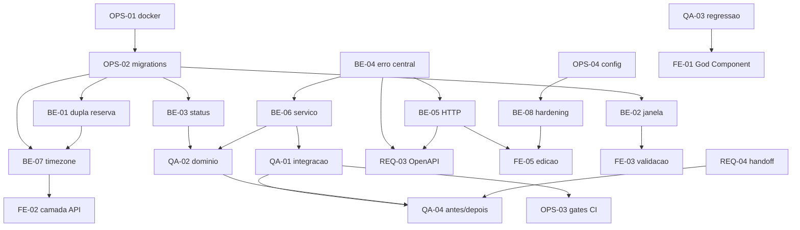

# Especificações de implementação

Uma pasta por issue. Cada `implementacao.md` traz o problema com arquivo e
linha, a evidência, a decisão de arquitetura e por que ela e não a alternativa
óbvia, o código proposto, os testes, os critérios de aceite, o passo a passo
TBD com as mensagens de commit prontas, e o prompt para o Claude Code.

A ideia é que ninguém precise reabrir a discussão na hora de implementar. Quem
pega a issue lê a spec e executa, ou roda:

```
/implementar <slug>
```

## O backlog

28 issues. As duas primeiras (`ONB-01` e `AUD-01`) são de diagnóstico e não têm
spec: a auditoria **já está entregue** em [`docs/auditoria/`](../auditoria/relatorio-n2.md).

### Backend — Adrian Cesar ([@adrian-cesar](https://github.com/adrian-cesar))

| Issue | Spec | Resolve | Sev. |
|---|---|---|---|
| [#3](https://github.com/igorSeberino/srec/issues/3) | [be-01-prevent-double-booking](be-01-prevent-double-booking/implementacao.md) | BUG-01 | CRÍTICO |
| [#4](https://github.com/igorSeberino/srec/issues/4) | [be-02-validate-reservation-window](be-02-validate-reservation-window/implementacao.md) | BUG-02, BUG-08, BUG-09, CS-04 | CRÍTICO |
| [#5](https://github.com/igorSeberino/srec/issues/5) | [be-03-restrict-reservation-status](be-03-restrict-reservation-status/implementacao.md) | BUG-03, BUG-10, CS-05 | ALTO |
| [#6](https://github.com/igorSeberino/srec/issues/6) | [be-04-central-error-middleware](be-04-central-error-middleware/implementacao.md) | CS-02 | ALTO |
| [#7](https://github.com/igorSeberino/srec/issues/7) | [be-05-proper-http-status-codes](be-05-proper-http-status-codes/implementacao.md) | BUG-04, BUG-05 | ALTO |
| [#8](https://github.com/igorSeberino/srec/issues/8) | [be-06-extract-service-layer](be-06-extract-service-layer/implementacao.md) | CS-03 | ALTO |
| [#9](https://github.com/igorSeberino/srec/issues/9) | [be-07-timezone-aware-timestamps](be-07-timezone-aware-timestamps/implementacao.md) | BUG-07 | ALTO |
| [#10](https://github.com/igorSeberino/srec/issues/10) | [be-08-harden-http-surface](be-08-harden-http-surface/implementacao.md) | BUG-11, BUG-12, CS-14 | MÉDIO |

### Frontend — Renato Colin ([@RenatoColin](https://github.com/RenatoColin))

| Issue | Spec | Resolve | Sev. |
|---|---|---|---|
| [#11](https://github.com/igorSeberino/srec/issues/11) | [fe-01-split-god-component](fe-01-split-god-component/implementacao.md) | CS-01, CS-08 | ALTO |
| [#12](https://github.com/igorSeberino/srec/issues/12) | [fe-02-api-layer-and-env-config](fe-02-api-layer-and-env-config/implementacao.md) | CS-07 | MÉDIO |
| [#13](https://github.com/igorSeberino/srec/issues/13) | [fe-03-form-validation-and-submit-lock](fe-03-form-validation-and-submit-lock/implementacao.md) | BUG-13 | BAIXO |
| [#14](https://github.com/igorSeberino/srec/issues/14) | [fe-04-accessibility-and-effect-cleanup](fe-04-accessibility-and-effect-cleanup/implementacao.md) | BUG-14, CS-12, CS-13 | BAIXO |
| [#15](https://github.com/igorSeberino/srec/issues/15) | [fe-05-resource-edit-and-cascade-warning](fe-05-resource-edit-and-cascade-warning/implementacao.md) | BUG-06, BUG-15 | ALTO |

### DevOps — Gabriel Carvalho ([@gabrielcarvallho](https://github.com/gabrielcarvallho))

| Issue | Spec | Resolve | Sev. |
|---|---|---|---|
| [#16](https://github.com/igorSeberino/srec/issues/16) | [ops-01-docker-compose-environment](ops-01-docker-compose-environment/implementacao.md) | CS-11, onboarding | — |
| [#17](https://github.com/igorSeberino/srec/issues/17) | [ops-02-versioned-migrations](ops-02-versioned-migrations/implementacao.md) | CS-06, CS-09 | MÉDIO |
| [#18](https://github.com/igorSeberino/srec/issues/18) | [ops-03-ci-quality-gates](ops-03-ci-quality-gates/implementacao.md) | CS-10 | MÉDIO |
| [#19](https://github.com/igorSeberino/srec/issues/19) | [ops-04-validated-config](ops-04-validated-config/implementacao.md) | BUG-11 (parcial) | MÉDIO |
| [#20](https://github.com/igorSeberino/srec/issues/20) | [ops-05-branch-protection-and-templates](ops-05-branch-protection-and-templates/implementacao.md) | processo | — |

### Requisitos — Diego Nessler ([@Diegonessler](https://github.com/Diegonessler))

| Issue | Spec | Resolve |
|---|---|---|
| [#21](https://github.com/igorSeberino/srec/issues/21) | [req-01-reverse-engineer-requirements](req-01-reverse-engineer-requirements/implementacao.md) | D-08, requisitos |
| [#22](https://github.com/igorSeberino/srec/issues/22) | [req-02-business-rules-and-der](req-02-business-rules-and-der/implementacao.md) | D-01, D-02, D-03 |
| [#23](https://github.com/igorSeberino/srec/issues/23) | [req-03-openapi-contract](req-03-openapi-contract/implementacao.md) | D-04, D-05, D-06, D-07 |
| [#24](https://github.com/igorSeberino/srec/issues/24) | [req-04-n3-handoff-document](req-04-n3-handoff-document/implementacao.md) | handoff N3 |

### QA e produto — Igor Seberino ([@igorSeberino](https://github.com/igorSeberino))

| Issue | Spec | Resolve |
|---|---|---|
| [#1](https://github.com/igorSeberino/srec/issues/1) | — | onboarding, M-23 |
| [#2](https://github.com/igorSeberino/srec/issues/2) | — | auditoria (**entregue**) |
| [#25](https://github.com/igorSeberino/srec/issues/25) | [qa-01-api-integration-suite](qa-01-api-integration-suite/implementacao.md) | M-01 a M-08 |
| [#26](https://github.com/igorSeberino/srec/issues/26) | [qa-02-domain-rule-tests](qa-02-domain-rule-tests/implementacao.md) | M-03, regra de domínio |
| [#27](https://github.com/igorSeberino/srec/issues/27) | [qa-03-test-plan-and-regression](qa-03-test-plan-and-regression/implementacao.md) | processo, regressão de FE-01 |
| [#28](https://github.com/igorSeberino/srec/issues/28) | [qa-04-before-after-report](qa-04-before-after-report/implementacao.md) | pitch |

## Ordem de execução

A ordem importa, e algumas dependências não são óbvias.

### Onda 1 — destravar o resto

Nada de backend avança sem schema versionado, e nada de teste avança sem
superfície de teste.

* **OPS-01** — ambiente em um comando. Primeiro porque todo mundo depende de ter o sistema rodando.
* **OPS-02** — migrations. **Bloqueia metade do backend:** BE-01, BE-02, BE-03 e BE-07 todos precisam alterar o schema.
* **OPS-04** — configuração validada. Pequena, e BE-08 depende.
* **BE-04** — middleware central de erro. **Bloqueia BE-05 e BE-06.**
* **QA-03** — roteiro de regressão. Precisa rodar **antes** de FE-01 para ter com o que comparar depois.
* **ONB-01** — o diário de onboarding precisa ser registrado antes de OPS-01 mergear, senão a fricção original desaparece e não dá para comprovar.

### Onda 2 — os bugs que valem a nota

* **BE-01** — dupla reserva. O achado principal da auditoria.
* **BE-02** — janela da reserva.
* **BE-03** — status e tipo.
* **BE-05** — códigos HTTP.
* **BE-06** — camada de serviço. **Bloqueia QA-01 e QA-02:** escrever teste antes dela é esforço jogado fora na primeira refatoração.
* **FE-01** — quebrar o God Component.
* **REQ-01**, **REQ-02** — requisitos e DER, podem correr em paralelo desde o início.

### Onda 3 — fechar

* **BE-07** — timezone. Depois de BE-01, porque muda a constraint de `tsrange` para `tstzrange`.
* **BE-08** — endurecer a superfície.
* **FE-02** a **FE-05** — FE-02 depois de BE-07, FE-05 depois de BE-05 e BE-08.
* **QA-01**, **QA-02** — a suíte, com a arquitetura já pronta.
* **OPS-03** — portões de qualidade, depois de QA-01 existir (o gate de cobertura precisa de cobertura para medir).
* **OPS-05** — proteção de branch. Perto do fim, porque endurecer o merge no meio da entrega atrasa todo mundo.
* **REQ-03** — OpenAPI, depois de BE-04 e BE-05, senão documenta o comportamento errado.

### Onda 4 — a entrega

* **REQ-04** — handoff para a N3.
* **QA-04** — relatório antes/depois e roteiro do pitch. Último, por definição.

## Grafo de dependências



## Rastreabilidade

Todo trabalho desta entrega nasce de um achado medido. A cadeia é:

```
achado da auditoria  ->  issue com label de severidade  ->  spec  ->  branch  ->  PR  ->  linha no relatório antes/depois
```

Se alguma issue não fecha essa cadeia, ela não deveria existir. É o que permite
o pitch dizer "corrigimos **estes** 15 bugs" em vez de "melhoramos o código".
