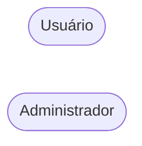
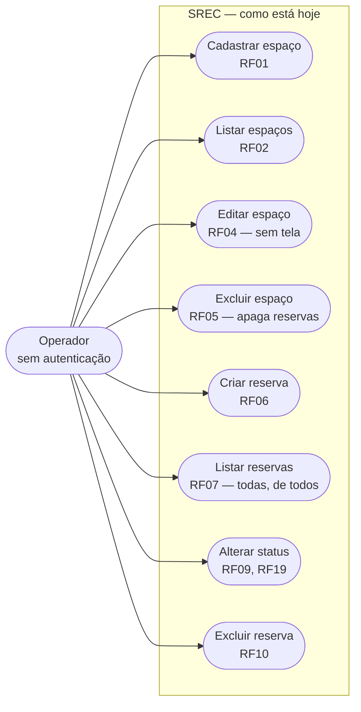

# REQ-01 — Engenharia reversa dos requisitos do SREC

* **Responsável:** Diego Nessler (`@Diegonessler`, Engenheiro de Requisitos)
* **Issue:** #<a definir>
* **Branch:** `docs/reverse-engineer-requirements`
* **Rubrica:** 3,0 — Processo, Git & Documentação (item de 1,5 — atualização dos diagramas/README e clareza das alterações para a N3); alimenta também o item de 4,0 — Onboarding e diagnóstico, por fechar o inventário do que o sistema realmente faz
* **Depende de:** nada (é a spec-raiz de requisitos; REQ-02, REQ-03 e REQ-04 consomem o `docs/produto/requisitos.md` produzido aqui)

## Problema

O repositório recebido não tem documento de requisitos. O que existe é
`Documentação Oficial SREC.md`, que na seção 3.1 lista **duas** histórias de
usuário genéricas (`Documentação Oficial SREC.md:25-27`):

```markdown
* **US01 - Cadastro Base:** Gestão e controle de espaços disponíveis, como estações de trabalho e salas de reunião.
* **US02/03 - Agendamento:** Garantia de disponibilidade em tempo real sem sobreposição de horários.
```

Duas frases para um sistema com 10 endpoints, 2 tabelas e 853 linhas de JS/JSX.
Nenhum critério de aceitação, nenhum requisito não funcional, nenhuma
rastreabilidade para código. Pior: a mesma documentação afirma coisas que o
código não faz. O diagrama de casos de uso
(`Documentação Oficial SREC.md:36-55`) declara dois atores:



e amarra `UC4 (Gerenciar Espaços - CRUD)` ao ator `admin`. Não existe
autenticação em nenhum ponto do backend: `server/src/index.js:12-18` registra
apenas `cors()` e `express.json()` antes das rotas, e nenhuma das duas rotas
tem middleware (`server/src/routes/resourceRoutes.js:5-9`,
`server/src/routes/reservationRoutes.js:5-9`). Qualquer pessoa com a URL
executa o CRUD completo de recursos.

Consequência para a N2: não é possível provar melhoria ("melhoria comprovada do
código recebido", 2,5 pt) sem antes declarar **qual era o comportamento
esperado**. Hoje, corrigir BUG-02 (reserva com `end_time` anterior a
`start_time`) não tem requisito contra o qual medir — a regra "janela válida"
não está escrita em lugar nenhum.

Há ainda um risco de processo: ao receber o pacote, o grupo da N3 vai ler a
documentação do grupo da N1 e acreditar que existe controle de acesso de
administrador, usuário identificado, coluna `is_active` e rota
`PUT /api/reservations/{id}/cancel`. Nenhuma das quatro coisas existe. Se nós
não registrarmos isso explicitamente, propagamos a ficção adiante.

## Evidência

### O que a documentação promete e o código não entrega

| # | Afirmação da doc recebida | Realidade no código | Evidência |
|---|---|---|---|
| D06 | `POST /api/resources` tem "Nível de acesso Admin" | não há autenticação nem autorização | `Documentação Oficial SREC.md:109` vs `server/src/index.js:12-18`, `server/src/routes/resourceRoutes.js:5` |
| D08 | Casos de uso separam `Usuário` e `Administrador` | o sistema não tem papéis nem sessão | `Documentação Oficial SREC.md:38-53` vs ausência de middleware nos dois arquivos de rota |
| D05 | `GET /api/reservations` lista "as reservas do usuário atual" | `SELECT * FROM reservations ORDER BY start_time ASC` — todas, de todos | `Documentação Oficial SREC.md:116` vs `server/src/models/reservationModel.js:15` |
| D03 | `reservations.user_id UUID` | `user_name VARCHAR(100) NOT NULL`, texto livre digitado no formulário | `Documentação Oficial SREC.md:94` vs `server/src/config/initDb.js:17` e `client/src/App.jsx:252-259` |
| D02 | `resources.is_active BOOLEAN` | a coluna não existe no `CREATE TABLE` | `Documentação Oficial SREC.md:88` vs `server/src/config/initDb.js:5-12` |
| D04 | `PUT /api/reservations/{id}/cancel` | a rota não existe; o que existe é `PATCH /api/reservations/:id/status` | `Documentação Oficial SREC.md:117` vs `server/src/routes/reservationRoutes.js:8` |
| D07 | 5 endpoints documentados | 10 implementados | `Documentação Oficial SREC.md:106-117` vs os 10 `router.<verbo>` dos dois arquivos de rota |

O catálogo completo das 12 divergências é tratado em **REQ-02**; aqui só
entram as que viram requisito.

### Os 10 endpoints que existem de fato

Levantados linha a linha dos dois arquivos de rota:

```
server/src/routes/resourceRoutes.js
  :5  POST   /api/resources            → ResourceController.createResource
  :6  GET    /api/resources            → ResourceController.getAllResources
  :7  GET    /api/resources/:id        → ResourceController.getResourceById
  :8  PUT    /api/resources/:id        → ResourceController.updateResource
  :9  DELETE /api/resources/:id        → ResourceController.deleteResource

server/src/routes/reservationRoutes.js
  :5  POST   /api/reservations         → ReservationController.createReservation
  :6  GET    /api/reservations         → ReservationController.getAllReservations
  :7  GET    /api/reservations/:id     → ReservationController.getReservationById
  :8  PATCH  /api/reservations/:id/status → ReservationController.updateReservationStatus
  :9  DELETE /api/reservations/:id     → ReservationController.deleteReservation
```

Mais `GET /` (`server/src/index.js:21-23`), que responde texto puro
`'SREC Coworking API is running...'` e não é parte do contrato de domínio.

### Funcionalidade implementada que nenhuma tela alcança

O cliente expõe 8 funções em `client/src/services/api.js`: `getResources`
(`:5`), `createResource` (`:11`), `updateResource` (`:24`), `deleteResource`
(`:37`), `getReservations` (`:46`), `createReservation` (`:52`),
`updateReservationStatus` (`:65`), `deleteReservation` (`:75`).

* `GET /api/resources/:id` e `GET /api/reservations/:id` **não têm nem função
  no `api.js`** — são alcançáveis só por `curl`.
* `updateResource` existe no `api.js:24-35` e **nenhum componente a chama**;
  `grep` por `updateResource` em `client/src/App.jsx` não retorna nada. É o
  BUG-15 (endpoint órfão).
* `ReservationModel.findByResourceId` (`server/src/models/reservationModel.js:26-30`)
  é código morto: não há controller nem rota que o invoque.

Isso define três requisitos com situações distintas: implementado sem
interface, implementado e órfão, e capacidade existente no model sem requisito
exposto.

### Baseline que o documento precisa citar

Medido conforme seção 5 do contexto da N2:

```bash
cd server && npm ci && npx jest --coverage --coverageReporters=text --collectCoverageFrom='src/**/*.js'
```

Resultado: **6,14 %** de statements, **0 %** de branches, **0 %** nos
controllers e nas rotas, 1 arquivo de teste, 2 casos. Ou seja: nenhum dos
requisitos funcionais levantados aqui tem teste automatizado hoje, exceto a
fórmula anti-sobreposição isolada do model
(`server/src/models/reservationModel.test.js:11-37`).

## Decisão

**Reconstruir os requisitos a partir do código, não a partir da documentação
recebida, e marcar cada requisito com um campo `Situação`.**

Por que esta e não a alternativa óbvia:

1. **A alternativa óbvia era "atualizar o documento do grupo anterior".**
   Rejeitada: o documento recebido mistura requisito, arquitetura, API, DevOps
   e guia de contribuição em um único arquivo de 159 linhas, e a convenção da
   N2 é "uma casa canônica por assunto" (seção 9 do contexto). Editar aquele
   arquivo manteria o acoplamento e perderia a separação
   `produto/` × `arquitetura/` × `time/`. Decisão: `Documentação Oficial SREC.md`
   é preservado **intacto** como documento histórico recebido, e passa a ser
   referenciado como tal; a verdade vive em `docs/produto/requisitos.md`.

2. **A segunda alternativa era escrever requisitos "corretos" — o que o sistema
   deveria fazer.** Rejeitada: a N2 é manutenção de software alheio. Requisito
   que o sistema não implementa é **débito declarado**, não requisito. Por isso
   o campo `Situação`, com vocabulário fechado de quatro valores, é obrigatório
   em todo item. Um requisito `não implementado` entra no documento com a mesma
   dignidade dos outros, mas o leitor sabe na primeira linha que ele não
   funciona.

3. **Formato de história de usuário com critério de aceitação verificável**, e
   não prosa. Motivo direto: QA-01 a QA-04 precisam transformar critério em
   teste. Critério que não vira `expect()` é critério inútil. Cada critério de
   aceitação é escrito de forma que o teste correspondente seja óbvio.

4. **Ator único.** O sistema não tem autenticação, logo tem exatamente um ator
   real. Chamá-lo de "Usuário" seria repetir o erro da doc recebida, que usa
   "Usuário" em oposição a "Administrador". Adotamos **`Operador`**: qualquer
   pessoa com acesso à URL da aplicação, com poder total e irrestrito sobre
   recursos e reservas. O nome carrega o diagnóstico. `Administrador` e
   `Usuário identificado` aparecem no documento apenas como atores
   **documentados mas inexistentes**.

5. **Vocabulário do campo `Situação`.** Exatamente quatro valores:

   | Valor | Significado |
   |---|---|
   | `implementado` | o código faz o que o requisito descreve, e os critérios de aceitação passam |
   | `implementado com defeito (BUG-nn)` | a capacidade existe mas tem defeito catalogado; cita o ID do catálogo de bugs da auditoria |
   | `documentado mas inexistente` | a documentação recebida afirma que existe; não existe uma linha de código |
   | `não implementado` | não existe e a documentação recebida também não prometia |

   **Extensão do parênteses:** quando o defeito for *code smell* e não bug de
   comportamento, o parênteses carrega o ID do catálogo de smells
   (`implementado com defeito (CS-nn)`). Isso vale principalmente para os RNFs.
   A regra é: o parênteses nunca fica vazio e sempre aponta para um item
   catalogado em `docs/auditoria/`.

6. **Rastreabilidade em três colunas, não em ferramenta.** A doc recebida
   afirma "todas as tarefas mapeadas no Jira"
   (`Documentação Oficial SREC.md:145`) e o repositório tem 0 issues e nenhum
   Jira. Não vamos adotar Jira. Cada requisito carrega, em texto, o arquivo e
   linha que o implementa e o ID da spec que o altera na N2. Rastreabilidade
   que vive no repositório sobrevive ao handoff; rastreabilidade em ferramenta
   externa não.

## Alterações

### Arquivos a criar

| Arquivo | Conteúdo |
|---|---|
| `docs/produto/requisitos.md` | o documento de requisitos reconstruído (conteúdo integral abaixo) |
| `scripts/check-requirements.mjs` | validador do vocabulário de `Situação` e da numeração sequencial |

### Arquivos a alterar

| Arquivo | O que muda |
|---|---|
| `README.md` | adicionar, na seção de documentação, link para `docs/produto/requisitos.md` e a frase que marca `Documentação Oficial SREC.md` como histórico recebido |

### Arquivos preservados sem alteração

* `Documentação Oficial SREC.md` — **não editar**. É prova material da
  divergência e insumo do pitch. Qualquer correção de conteúdo acontece nos
  documentos novos.

### `docs/produto/requisitos.md` — documento completo

> O bloco abaixo é o arquivo a criar, na íntegra. Os requisitos RF01–RF06,
> RF11, RF13–RF15 e RNF01–RNF04 estão escritos por extenso e **definem o
> padrão**. Os demais estão no índice com `Situação` e evidência já fixadas, e
> devem ser expandidos no mesmo formato, sem inventar nada além do que o código
> mostra.

````markdown
# Requisitos do SREC — reconstruídos por engenharia reversa

Este documento **não** descreve o sistema que gostaríamos de ter. Descreve o
sistema que o grupo da N2 recebeu, derivado linha a linha do código em
`server/src/` e `client/src/`.

A documentação recebida do grupo anterior (`Documentação Oficial SREC.md`) é
preservada no repositório como registro histórico e **não é fonte de verdade**.
Onde ela divergir do código, o código vence. O catálogo das divergências está
em `docs/arquitetura/der.md` e no relatório de auditoria em `docs/auditoria/`.

## Como ler este documento

Cada requisito tem:

* **Identificador** — `RFnn` (funcional) ou `RNFnn` (não funcional).
* **História** — `Como <ator>, quero <ação>, para <benefício>`.
* **Situação** — um de quatro valores, e nada além deles:
  * `implementado` — o código faz o que está escrito e os critérios passam.
  * `implementado com defeito (BUG-nn)` ou `(CS-nn)` — existe, com defeito
    catalogado na auditoria.
  * `documentado mas inexistente` — a doc recebida promete; não há código.
  * `não implementado` — não existe e a doc recebida também não prometia.
* **Evidência** — arquivo e linha que sustentam a situação declarada.
* **Critérios de aceitação** — verificáveis, no formato que QA-01..QA-04
  convertem em teste automatizado.
* **Trabalho na N2** — qual spec mexe nisso, ou `nenhum (débito da N3)`.

Requisito com `Situação` diferente de `implementado` **não** é promessa de
entrega. Entrega é o que está em `docs/specs/`.

## Atores

| Ator | Existe no código? | Observação |
|---|---|---|
| **Operador** | sim | Qualquer pessoa com acesso à URL. Não há login, sessão, token ou cabeçalho de identificação. Tem poder total sobre recursos e reservas. É o único ator real do sistema. Evidência: `server/src/index.js:12-18` registra só `cors()` e `express.json()`; nenhuma rota tem middleware de autenticação (`server/src/routes/resourceRoutes.js:5-9`, `server/src/routes/reservationRoutes.js:5-9`). |
| **Administrador** | não | A doc recebida o declara em `Documentação Oficial SREC.md:39` e amarra a ele o CRUD de espaços (`:52`), e marca `POST /api/resources` como "Nível de acesso Admin" (`:109`). Não há uma linha de autorização no código. Ver RF14. |
| **Usuário identificado** | não | A doc recebida declara `reservations.user_id UUID` (`:94`) e afirma que `GET /api/reservations` lista "as reservas do usuário atual" (`:116`). O schema tem `user_name VARCHAR(100)` preenchido por digitação livre (`server/src/config/initDb.js:17`, `client/src/App.jsx:252-259`). Ver RF13. |

Enquanto só existir o ator `Operador`, **todo requisito de visibilidade,
propriedade ou permissão é vácuo**. Isso não é opinião: é o que explica RF13 e
RF14 serem `documentado mas inexistente`.

## Requisitos funcionais

### RF01 — Cadastrar recurso

**História.** Como Operador, quero cadastrar uma estação de trabalho ou sala de
reunião informando nome, tipo e capacidade, para que ela possa ser reservada.

**Situação.** `implementado com defeito (BUG-09)`

**Evidência.** `POST /api/resources` em
`server/src/routes/resourceRoutes.js:5` → `ResourceController.createResource`
(`server/src/controllers/resourceController.js:4-16`) →
`ResourceModel.create` (`server/src/models/resourceModel.js:4-12`). O
formulário está em `client/src/App.jsx:161-198`.

**Critérios de aceitação.**

1. `POST /api/resources` com `{ "name": "Sala Alpha", "type": "meeting_room", "capacity": 8 }`
   responde `201` e o corpo contém `id`, `name`, `type`, `capacity`,
   `created_at`, `updated_at` — porque o `INSERT` usa `RETURNING *`
   (`server/src/models/resourceModel.js:8`).
2. `POST /api/resources` sem `name` **ou** sem `type` responde `400` com
   `{"error":"Name and type are required"}` — `resourceController.js:7-9`.
3. `POST /api/resources` sem `capacity` responde `201` com `capacity: 1` —
   `resourceController.js:10` passa `capacity || 1`.
4. **Falha hoje (BUG-09):** `POST` com `capacity: 0` deveria responder `400`;
   hoje responde `201` com `capacity: 1`, porque `0 || 1 === 1` em
   `resourceController.js:10`. O dado do Operador é silenciosamente trocado.
5. **Falha hoje (BUG-09):** `POST` com `capacity: -5` deveria responder `400`;
   hoje responde `201` e grava `-5`, porque `-5` é *truthy* e o schema não tem
   `CHECK` (`server/src/config/initDb.js:9`).

**Trabalho na N2.** BE-02 (validação de entrada e `CHECK` no schema).

---

### RF02 — Listar recursos

**História.** Como Operador, quero ver a lista de todos os espaços
cadastrados com tipo e capacidade, para escolher onde reservar.

**Situação.** `implementado`

**Evidência.** `GET /api/resources` em
`server/src/routes/resourceRoutes.js:6` → `getAllResources`
(`resourceController.js:18-26`) → `SELECT * FROM resources ORDER BY id ASC`
(`resourceModel.js:15`). Renderizado em `client/src/App.jsx:201-226`.

**Critérios de aceitação.**

1. `GET /api/resources` responde `200` com um array JSON, ordenado por `id`
   crescente — `resourceModel.js:15`.
2. Com a tabela vazia, responde `200` com `[]` (não `404`), e o cliente exibe
   "Nenhum espaço cadastrado ainda." — `client/src/App.jsx:204`.
3. A resposta inclui todas as colunas da tabela, inclusive `created_at` e
   `updated_at`, porque a consulta é `SELECT *`.

**Nota de divergência.** A doc recebida descreve este endpoint como "Lista
todos os espaços **disponíveis**" (`Documentação Oficial SREC.md:108`). Ele
lista **todos**, sem qualquer filtro: não há `WHERE`, não há `is_active` (ver
RF15) e não há cruzamento com reservas. A palavra "disponíveis" é falsa.
Corrigida em `docs/arquitetura/openapi.yaml` (REQ-03).

**Trabalho na N2.** nenhum no comportamento; REQ-03 corrige a descrição do
contrato.

---

### RF03 — Consultar um recurso por identificador

**História.** Como Operador, quero consultar um espaço específico pelo seu
identificador, para ver seus dados isoladamente.

**Situação.** `implementado com defeito (BUG-04)`

**Evidência.** `GET /api/resources/:id` em
`server/src/routes/resourceRoutes.js:7` → `getResourceById`
(`resourceController.js:28-40`) → `SELECT * FROM resources WHERE id = $1`
(`resourceModel.js:21`).

**Critérios de aceitação.**

1. `GET /api/resources/1` com o recurso 1 existente responde `200` com o
   objeto.
2. `GET /api/resources/99999` responde `404` com
   `{"error":"Resource not found"}` — `resourceController.js:32-34`.
3. **Falha hoje (BUG-04):** `GET /api/resources/abc` deveria responder `400`;
   hoje responde `500`. O Postgres levanta `22P02 invalid input syntax for
   type integer: "abc"` dentro do `await`, o `catch` de
   `resourceController.js:36-39` transforma tudo em
   `{"error":"Internal server error"}`. O mesmo vale para as seis rotas com
   `:id`.

**Nota de cobertura de interface.** Nenhuma tela chama este endpoint: não
existe função correspondente em `client/src/services/api.js` (as 8 funções
estão nas linhas `:5`, `:11`, `:24`, `:37`, `:46`, `:52`, `:65`, `:75`). É
alcançável apenas por cliente HTTP direto. Isso **não** é defeito do endpoint;
é escopo de produto não entregue.

**Trabalho na N2.** BE-04 (validação de `:id` e formato de erro
padronizado).

---

### RF04 — Atualizar um recurso

**História.** Como Operador, quero corrigir nome, tipo ou capacidade de um
espaço já cadastrado, para manter o cadastro fiel à realidade física.

**Situação.** `implementado com defeito (BUG-05)`

**Evidência.** `PUT /api/resources/:id` em
`server/src/routes/resourceRoutes.js:8` → `updateResource`
(`resourceController.js:42-55`) → `ResourceModel.update`
(`resourceModel.js:26-35`).

**Critérios de aceitação.**

1. `PUT /api/resources/1` com `{ "name": "Alpha", "type": "meeting_room", "capacity": 10 }`
   responde `200` com o objeto atualizado e `updated_at` renovado —
   `resourceModel.js:29` faz `updated_at = CURRENT_TIMESTAMP`.
2. `PUT /api/resources/99999` com corpo completo responde `404` —
   `resourceController.js:47-49`.
3. **Falha hoje (BUG-05):** `PUT /api/resources/1` com corpo parcial
   `{ "capacity": 4 }` deveria responder `200` preservando `name` e `type`,
   ou `400` exigindo o corpo completo. Hoje responde `500`: o controller
   desestrutura `name` e `type` como `undefined`
   (`resourceController.js:45`), o driver `pg` converte `undefined` em `NULL`,
   e o `UPDATE` de `resourceModel.js:29` viola
   `name VARCHAR(100) NOT NULL` (`initDb.js:7`). O erro é engolido pelo
   `catch` (`resourceController.js:51-54`).
4. **Falha hoje (BUG-15):** nenhuma tela chama este endpoint. A função
   `api.updateResource` existe em `client/src/services/api.js:24-35` e não é
   referenciada em `client/src/App.jsx`. É funcionalidade paga e não
   entregue.

**Trabalho na N2.** BE-05 (semântica de `PUT` com corpo completo e validação),
FE-03 (expor a edição na interface) — confirmar a divisão com
`@adrian-cesar` e `@RenatoColin`.

---

### RF05 — Excluir um recurso

**História.** Como Operador, quero remover um espaço do cadastro, para que ele
deixe de aparecer como reservável.

**Situação.** `implementado com defeito (BUG-06)`

**Evidência.** `DELETE /api/resources/:id` em
`server/src/routes/resourceRoutes.js:9` → `deleteResource`
(`resourceController.js:57-69`) →
`DELETE FROM resources WHERE id = $1 RETURNING *` (`resourceModel.js:38`).
Interface em `client/src/App.jsx:216-222`, com `window.confirm`
(`App.jsx:77`).

**Critérios de aceitação.**

1. `DELETE /api/resources/1` responde `200` com
   `{"message":"Resource deleted successfully"}` — `resourceController.js:64`.
2. `DELETE /api/resources/99999` responde `404` —
   `resourceController.js:61-63`.
3. **Falha hoje (BUG-06):** excluir um recurso que possui reservas deveria ser
   bloqueado (`409`) ou pedir confirmação explícita da perda. Hoje apaga em
   silêncio **todas** as reservas daquele recurso, porque
   `server/src/config/initDb.js:16` declara
   `resource_id INTEGER REFERENCES resources(id) ON DELETE CASCADE`. O
   histórico desaparece sem aviso e sem registro. O texto do
   `window.confirm` em `client/src/App.jsx:77` — "Deseja realmente remover
   este espaço?" — não menciona a perda de reservas.

**Trabalho na N2.** correção catalogada como BUG-06 no escopo de backend;
confirmar com `@adrian-cesar` qual spec entre BE-05, BE-06 e BE-08 a absorve.
Se não entrar na N2, vira débito explícito no handoff (REQ-04).

---

### RF06 — Criar reserva sem sobreposição de horário

**História.** Como Operador, quero reservar um espaço informando responsável,
início e fim, para garantir uso exclusivo naquele intervalo.

**Situação.** `implementado com defeito (BUG-01)`

Este é o requisito central do produto. Os defeitos BUG-02, BUG-07 e BUG-08
também incidem sobre ele e estão nos critérios abaixo.

**Evidência.** `POST /api/reservations` em
`server/src/routes/reservationRoutes.js:5` → `createReservation`
(`server/src/controllers/reservationController.js:4-34`), que chama
`ReservationModel.checkAvailability` (`reservationModel.js:49-61`) e, se
disponível, `ReservationModel.create` (`reservationModel.js:4-12`). Formulário
em `client/src/App.jsx:234-284`.

A fórmula anti-sobreposição documentada em
`Documentação Oficial SREC.md:72` —
`Início_banco < Fim_novo AND Fim_banco > Início_novo` — **confere** com a
implementada em `reservationModel.js:55`:
`(start_time < $3 AND end_time > $2)`, com `$2 = start_time` novo e
`$3 = end_time` novo (parâmetros em `reservationModel.js:59`). A fórmula está
certa. O problema está em executá-la fora de transação e sem constraint.

**Critérios de aceitação.**

1. `POST /api/reservations` com
   `{ "resource_id": 1, "user_name": "Carlos", "start_time": "2026-11-03T09:00", "end_time": "2026-11-03T10:00" }`
   em recurso livre responde `201`, e o corpo traz `status: "scheduled"` por
   default do schema (`initDb.js:20`).
2. Faltando qualquer um dos quatro campos, responde `400` com
   `{"error":"All fields are required"}` — `reservationController.js:7-9`.
3. Sobreposição parcial com reserva existente responde `409` com
   `{"error":"Resource is not available for the selected time slot"}` —
   `reservationController.js:17-21`.
4. Reserva encostada (`end_time` de uma igual ao `start_time` da outra) é
   aceita com `201`, porque a comparação é estritamente `<` e `>`
   (`reservationModel.js:55`). Comportamento correto e intencional.
5. Reserva cujo conflito está com uma reserva `cancelled` é aceita, porque a
   consulta filtra `status != 'cancelled'` (`reservationModel.js:53`).
6. **Falha hoje (BUG-01):** duas requisições concorrentes para o mesmo
   intervalo deveriam resultar em uma `201` e uma `409`. Hoje as duas podem
   responder `201`. Entre a leitura em `reservationController.js:12-16` e a
   escrita em `:23-28` não há transação, nem `SELECT ... FOR UPDATE`, nem
   constraint no banco (`initDb.js:14-23` não tem `EXCLUDE`). É a janela
   TOCTOU clássica. **Teste que falha antes da correção:** disparar 10
   `POST` simultâneos com o mesmo intervalo e exigir exatamente 1 `201`.
7. **Falha hoje (BUG-02):** `end_time` anterior a `start_time` deveria
   responder `400`. Hoje responde `201`, e pior: a reserva invertida **nunca
   colide com nada**, porque `start_time < $3 AND end_time > $2` é
   insatisfazível quando o intervalo é vazio. Ou seja, o dado corrompido
   também fica invisível à regra central. Não há validação no controller
   (`reservationController.js:7` só checa presença) nem `CHECK` no schema.
8. **Falha hoje (BUG-08):** reserva inteiramente no passado deveria responder
   `400`. Hoje é aceita com `201`; não há comparação com `NOW()` em nenhum
   ponto de `reservationController.js`.
9. **Falha hoje (BUG-07):** o horário gravado deve ser o horário que o
   Operador digitou. Hoje desloca: `client/src/App.jsx:263-269` usa
   `<input type="datetime-local">`, que produz string sem offset
   (`2026-11-03T09:00`), e as colunas são `TIMESTAMP` sem fuso
   (`initDb.js:18-19`). A leitura em `client/src/App.jsx:303-304` aplica
   `new Date(...).toLocaleString('pt-BR')`, que **reinterpreta** o valor como
   UTC e exibe outro horário.

**Trabalho na N2.** BE-01 (constraint `EXCLUDE` + transação), BE-02
(`CHECK` de janela e validação de entrada), BE-07 (`TIMESTAMPTZ`), FE-02
(envio do horário com offset).

---

### RF07 — Listar reservas

**História.** Como Operador, quero ver todas as reservas registradas em ordem
cronológica, para acompanhar a ocupação dos espaços.

**Situação.** `implementado`

**Evidência.** `GET /api/reservations` em
`server/src/routes/reservationRoutes.js:6` → `getAllReservations`
(`reservationController.js:36-44`) →
`SELECT * FROM reservations ORDER BY start_time ASC`
(`reservationModel.js:15`). Renderizado em `client/src/App.jsx:287-343`.

**Critérios de aceitação.**

1. Responde `200` com array ordenado por `start_time` crescente.
2. Retorna reservas de **todos** os responsáveis e em **todos** os status,
   inclusive `cancelled` — não há `WHERE` na consulta.
3. Com a tabela vazia, responde `200` com `[]`, e o cliente exibe "Nenhuma
   reserva registrada." — `client/src/App.jsx:290`.

**Nota de divergência.** A doc recebida descreve este endpoint como "Lista as
reservas **do usuário atual**" (`Documentação Oficial SREC.md:116`). Não
existe usuário atual — ver RF13. A descrição é falsa e está corrigida em
`docs/arquitetura/openapi.yaml` (REQ-03).

**Trabalho na N2.** CS-09 cobre a ausência de índices sobre
`resource_id`/`start_time`; a listagem em si não muda.

---

### RF08 — Consultar uma reserva por identificador

**Situação.** `implementado com defeito (BUG-04)`

**Evidência.** `server/src/routes/reservationRoutes.js:7` →
`reservationController.js:46-58` → `reservationModel.js:20-24`. Sem função
correspondente em `client/src/services/api.js` — alcançável só por cliente
HTTP direto.

> Expandir no padrão de RF03: `200` com objeto, `404` inexistente, `400`
> esperado e `500` observado para `:id` não numérico.

**Trabalho na N2.** BE-04.

---

### RF09 — Alterar o status de uma reserva

**Situação.** `implementado com defeito (BUG-03)`

**Evidência.** `PATCH /api/reservations/:id/status` em
`server/src/routes/reservationRoutes.js:8` →
`updateReservationStatus` (`reservationController.js:60-73`) →
`ReservationModel.updateStatus` (`reservationModel.js:32-41`). Acionado em
`client/src/App.jsx:317` (`'completed'`) e `:324` (`'cancelled'`).

Dois agravantes a registrar por extenso ao expandir:

* O controller **não valida** `status`:
  `PATCH /api/reservations/1/status` com `{"status":"banana"}` grava
  `banana` e responde `200`. Não há `CHECK` no schema
  (`initDb.js:20`) nem verificação em `reservationController.js:60-64`.
* Requisição **sem** `status` no corpo faz `req.body.status` ser `undefined`,
  o driver `pg` converte em `NULL`, e `status` fica nulo. A partir daí, aquela
  reserva **desaparece da regra anti-sobreposição**: em
  `reservationModel.js:53`, `NULL != 'cancelled'` avalia para `NULL`, que não
  satisfaz o `WHERE`. Uma reserva com status nulo deixa de bloquear qualquer
  horário. BUG-03 é, na prática, um caminho para corromper RF06.

**Trabalho na N2.** BE-03 (`CHECK` de status + validação no controller).

---

### RF10 — Excluir uma reserva definitivamente

**Situação.** `implementado`

**Evidência.** `DELETE /api/reservations/:id` em
`server/src/routes/reservationRoutes.js:9` →
`reservationController.js:75-87` → `reservationModel.js:43-47`. Interface em
`client/src/App.jsx:331-337`, com `window.confirm` em `:117`.

**Ambiguidade de produto a registrar.** A exclusão física coexiste com o
cancelamento por status (RF09), e a interface mistura os dois: o
`window.confirm` do botão de exclusão diz "Deseja **cancelar** esta reserva
permanentemente?" (`client/src/App.jsx:117`) enquanto o `title` do mesmo botão
diz "Excluir Definitivamente" (`:334`) e o feedback diz "Reserva removida!"
(`:120`). Três vocabulários para uma ação. Não é bug de código; é débito de
produto. Registrado no handoff (REQ-04).

---

### RF11 — Cancelar reserva por rota dedicada

**História.** Como Operador, quero cancelar uma reserva por uma rota de
cancelamento dedicada, para que a intenção "cancelar" seja explícita no
contrato da API.

**Situação.** `documentado mas inexistente`

**Evidência.** A doc recebida lista
`PUT /api/reservations/{id}/cancel` — "Cancela uma reserva existente"
(`Documentação Oficial SREC.md:117`). O arquivo de rotas
`server/src/routes/reservationRoutes.js` tem exatamente cinco registros
(linhas `5` a `9`) e **nenhum** deles é `PUT`, nem contém o segmento
`cancel`. A chamada `PUT /api/reservations/1/cancel` cai no handler padrão do
Express 5 e responde `404`.

O cancelamento **existe**, por outro caminho: `PATCH
/api/reservations/:id/status` com `{"status":"cancelled"}`, que é o que o
cliente faz em `client/src/App.jsx:324`.

**Critérios de aceitação (se um dia for implementado).**

1. `PUT /api/reservations/{id}/cancel` em reserva `scheduled` responde `200`
   com `status: "cancelled"`.
2. A mesma chamada em reserva já `cancelled` responde `409`.
3. A mesma chamada em `{id}` inexistente responde `404`.

**Decisão da N2.** **Não implementar.** O cancelamento já é alcançável por
`PATCH /:id/status`, que será endurecido por BE-03. Criar um segundo caminho
para o mesmo efeito aumentaria a superfície da API sem benefício para o
usuário, e a rubrica da N2 premia melhoria comprovada do código recebido, não
novas rotas. A resolução adotada é **corrigir a documentação**: o contrato em
`docs/arquitetura/openapi.yaml` (REQ-03) documenta `PATCH /:id/status` como o
único caminho de transição de status, e o handoff (REQ-04) registra a rota
`/cancel` como ficção herdada, já descartada, para que a N3 não a procure.

---

### RF12 — Listar as reservas de um recurso específico

**História.** Como Operador, quero ver a agenda de um espaço específico, para
avaliar sua ocupação antes de reservar.

**Situação.** `não implementado`

**Evidência.** A capacidade **existe no model e não está exposta**:
`ReservationModel.findByResourceId` em
`server/src/models/reservationModel.js:26-30` executa
`SELECT * FROM reservations WHERE resource_id = $1 ORDER BY start_time ASC`.
Nenhum controller a chama (`grep findByResourceId server/src/controllers/`
não retorna nada) e nenhuma rota a expõe. É código morto escrito e nunca
ligado.

A doc recebida também não promete este endpoint
(`Documentação Oficial SREC.md:106-117` lista cinco, nenhum por recurso) — por
isso `não implementado` e não `documentado mas inexistente`.

**Trabalho na N2.** nenhum. É a evolução mais barata para a N3 e está marcada
como tal em `docs/handoff/n3.md`: o model já existe, basta controller + rota +
teste.

---

### RF13 — Identificar quem fez a reserva

**História.** Como Operador, quero que a reserva esteja vinculada a um usuário
identificado do sistema, para que seja possível saber de quem é a reserva e
listar "minhas reservas".

**Situação.** `documentado mas inexistente`

**Evidência.** A doc recebida declara `UUID user_id` na entidade
`RESERVATION` (`Documentação Oficial SREC.md:94`) e afirma que
`GET /api/reservations` lista "as reservas do usuário atual" (`:116`). O que
existe:

* `server/src/config/initDb.js:17` — `user_name VARCHAR(100) NOT NULL`, texto
  livre. Não há tabela `users`, não há FK, não há unicidade.
* `client/src/App.jsx:252-259` — um `<input type="text">` com placeholder
  "Ex: Carlos Silva". O Operador digita o nome que quiser; dois Operadores
  podem digitar `"Carlos"` e o sistema os trata como a mesma string sem
  tratá-los como a mesma pessoa.
* `server/src/models/reservationModel.js:15` — `findAll` sem `WHERE`: não há
  nem filtro por `user_name`, muito menos por usuário autenticado.

**Critérios de aceitação (se um dia for implementado).**

1. Existe entidade de usuário persistida com identificador estável.
2. `reservations` referencia essa entidade por chave estrangeira.
3. `GET /api/reservations` filtra pelo usuário da sessão.
4. Um usuário não consegue alterar nem excluir reserva de outro.

**Decisão da N2.** **Não implementar.** Introduzir identidade de usuário
implica tabela nova, autenticação, sessão, migração do dado existente de
`user_name` e reescrita das telas — ou seja, nova funcionalidade complexa, que
é literalmente o escopo da N3 ("evoluir novas funcionalidades complexas"), não
da N2. Resolução: **corrigir a documentação** (o DER real em
`docs/arquitetura/der.md` mostra `user_name VARCHAR(100)`, sem `user_id`) e
**registrar como débito priorizado** em `docs/handoff/n3.md`. O que a N2 faz é
deixar o terreno pronto: com `CHECK` de status (BE-03) e constraint `EXCLUDE`
(BE-01) no banco, acrescentar uma coluna `user_id` depois não exige rediscutir
a regra de integridade central.

---

### RF14 — Restringir a gestão de espaços a administradores

**História.** Como Administrador, quero ser o único capaz de cadastrar,
alterar e excluir espaços, para que operadores comuns não alterem o cadastro
físico do coworking.

**Situação.** `documentado mas inexistente`

**Evidência.** A doc recebida marca `POST /api/resources` como "Cadastra um
novo espaço - **Nível de acesso Admin**"
(`Documentação Oficial SREC.md:109`) e, no diagrama de casos de uso, liga
`UC4 (Gerenciar Espaços - CRUD)` exclusivamente ao ator `admin` (`:45`,
`:52`). O que existe:

* `server/src/index.js:12-18` — a cadeia de middlewares é `cors()` e
  `express.json()`. Nada mais. E `cors()` sem argumento libera **qualquer**
  origem (CS-14).
* `server/src/routes/resourceRoutes.js:5-9` — os cinco `router.<verbo>`
  passam direto para o controller, sem middleware intermediário.
* `server/src/controllers/resourceController.js` — nenhuma leitura de
  `req.headers.authorization`, nenhum `req.user`, 72 linhas sem uma linha de
  autorização.
* `server/package.json:18-23` — as dependências de produção são `cors`,
  `dotenv`, `express` e `pg`. Não há `jsonwebtoken`, `passport`, `bcrypt` nem
  equivalente. Não existe nem o material para fazer autenticação.

Qualquer pessoa na rede executa
`curl -X DELETE http://localhost:5000/api/resources/1` e apaga um espaço —
junto com todas as reservas dele, por RF05/BUG-06.

**Critérios de aceitação (se um dia for implementado).**

1. `POST`, `PUT` e `DELETE` em `/api/resources` sem credencial respondem
   `401`.
2. Com credencial de operador comum, respondem `403`.
3. Com credencial de administrador, respondem `201`/`200`.
4. `GET /api/resources` segue público, ou passa a exigir sessão — decisão de
   produto a tomar junto.

**Decisão da N2.** **Não implementar.** Autenticação e autorização são
funcionalidade nova e dependem de RF13 (não há a quem atribuir papel sem
usuário). A N2 corrige o código recebido e **declara a lacuna**; não inventa
um módulo de segurança em uma semana sem requisito de negócio validado.
Resolução: **corrigir a documentação** (remover "Nível de acesso Admin" do
contrato e o ator `Administrador` do diagrama de casos de uso, em REQ-02) e
**registrar como débito de severidade alta** no handoff (REQ-04), junto com
CS-14 (`cors()` aberto, sem `helmet`, sem *rate limit*).

---

### RF15 — Ativar e inativar um espaço

**História.** Como Operador, quero marcar um espaço como inativo sem excluí-lo,
para tirá-lo de circulação durante manutenção preservando o histórico de
reservas.

**Situação.** `documentado mas inexistente`

**Evidência.** A doc recebida declara `BOOLEAN is_active` na entidade
`RESOURCE` (`Documentação Oficial SREC.md:88`). A coluna **não existe**: o
`CREATE TABLE resources` em `server/src/config/initDb.js:5-12` tem exatamente
`id`, `name`, `type`, `capacity`, `created_at`, `updated_at`. Consequências em
cascata:

* `ResourceModel` não a lê nem escreve: `create` insere três colunas
  (`resourceModel.js:6`), `update` atualiza três (`resourceModel.js:29`).
* `GET /api/resources` não pode filtrar por ela — o que explica por que a
  descrição "lista todos os espaços **disponíveis**"
  (`Documentação Oficial SREC.md:108`) é falsa (ver RF02).
* A única forma de tirar um espaço de circulação hoje é `DELETE`, que apaga o
  histórico de reservas por `ON DELETE CASCADE` (RF05/BUG-06). A ausência de
  `is_active` **transforma uma inativação temporária em perda de dado
  permanente**.

**Critérios de aceitação (se um dia for implementado).**

1. `resources` tem `is_active BOOLEAN NOT NULL DEFAULT TRUE`.
2. `GET /api/resources?active=true` retorna só os ativos.
3. `POST /api/reservations` para recurso inativo responde `409`.
4. Reservas já existentes de um recurso inativado permanecem consultáveis.

**Decisão da N2.** **Não implementar na N2.** A coluna é barata; o que não é
barato é a cadeia que ela puxa — filtro na listagem, bloqueio na criação de
reserva, tela de alternância, migração. Além disso, a decisão correta sobre
RF05/BUG-06 (trocar `CASCADE` por `RESTRICT`) muda o desenho de `is_active`:
com `RESTRICT`, a inativação deixa de ser paliativo para exclusão e passa a
ser estado de produto legítimo. Fazer as duas na ordem errada custa retrabalho.
Resolução: **corrigir a documentação** (o DER real não tem `is_active`) e
**registrar como a evolução de melhor relação custo-benefício para a N3** em
`docs/handoff/n3.md`.

---

### RF16 — Visualizar disponibilidade dos espaços

**Situação.** `implementado com defeito (CS-08)`

**Evidência.** A doc recebida promete "feedback dinâmico e em tempo real sobre
a disponibilidade das salas" (`Documentação Oficial SREC.md:127`). O que
existe é a aba "Agendamentos" listando reservas
(`client/src/App.jsx:287-343`), recarregada por `loadData()`
(`App.jsx:37-51`) a cada mutação (`:70`, `:81`, `:100`, `:110`, `:121`). Não
há endpoint de disponibilidade, não há polling, não há WebSocket. "Tempo real"
significa, na prática, "recarrega tudo depois que você clica". A
disponibilidade só é avaliada no instante do `POST`, dentro de
`checkAvailability` (`reservationModel.js:49-61`).

> Expandir no padrão acima.

**Trabalho na N2.** FE-04 (atualização de estado sem refetch total) — confirmar
com `@RenatoColin`.

---

### RF17 — Navegar entre espaços e agendamentos por abas

**Situação.** `implementado`

**Evidência.** `client/src/App.jsx:142-155` (dois botões de aba controlados por
`activeTab`, `App.jsx:15`) e os dois blocos condicionais em `:157` e `:230`.

---

### RF18 — Receber retorno visual do resultado de cada operação

**Situação.** `implementado com defeito (BUG-14)`

**Evidência.** `showFeedback` em `client/src/App.jsx:32-35` grava a mensagem e
agenda a limpeza com `setTimeout(..., 4000)`; o retorno do `setTimeout` nunca
é guardado nem limpo, logo um desmonte dentro da janela de 4 s dispara
`setState` em componente desmontado. Renderizado em `App.jsx:140`.

---

### RF19 — Concluir uma reserva realizada

**Situação.** `implementado com defeito (BUG-03)`

**Evidência.** `client/src/App.jsx:311-321` chama
`handleStatusChange(rev.id, 'completed')`, que usa o mesmo
`PATCH /:id/status` de RF09. Os botões de concluir e cancelar só aparecem se
`rev.status === 'scheduled'` (`App.jsx:309`), o que implementa o ciclo de vida
`scheduled → completed | cancelled` descrito em
`Documentação Oficial SREC.md:32` — mas **somente na interface**. A API aceita
qualquer transição, de qualquer estado para qualquer string (BUG-03).

---

## Requisitos não funcionais

### RNF01 — Persistência relacional em PostgreSQL

**História.** Como time de manutenção, quero que recursos e reservas vivam em
PostgreSQL, para que o dado sobreviva a reinícios e seja consultável por SQL.

**Situação.** `implementado`

**Evidência.** `server/src/config/database.js:4-6` cria um `Pool` do `pg` a
partir de `process.env.DATABASE_URL`; `server/package.json:22` fixa
`pg ^8.23.0`; os dois models usam SQL cru parametrizado
(`resourceModel.js`, `reservationModel.js`).

**Critérios de aceitação.**

1. Subindo o servidor com `DATABASE_URL` válida, o log imprime
   `Connected to PostgreSQL Database` — `database.js:8-10`.
2. Toda consulta usa parâmetros posicionais (`$1`, `$2`, ...), nunca
   concatenação de string. Verificável: não há template literal com
   interpolação de variável dentro de string SQL nos dois models.
3. Dado gravado permanece após reiniciar o processo.

---

### RNF02 — Evolução do schema por migrations versionadas

**História.** Como time de manutenção, quero que toda mudança de schema seja um
arquivo versionado e aplicável em ordem, para que qualquer ambiente chegue ao
mesmo estado de banco.

**Situação.** `não implementado`

**Evidência.** O schema é efeito colateral do boot:
`server/src/index.js:26-31` chama `await initDb()` antes de `app.listen`, e
`server/src/config/initDb.js:4-24` é um único `CREATE TABLE IF NOT EXISTS`
literal. Não existe pasta de migrations no repositório, nenhuma dependência de
migração em `server/package.json:18-33`, e nenhum script `migrate` em
`server/package.json:6-13`.

O efeito prático é grave e precisa estar escrito: por causa do
`IF NOT EXISTS`, **em qualquer banco que já tenha as tabelas, nenhuma alteração
de schema é aplicada**. Acrescentar uma coluna ou constraint editando
`initDb.js` não produz efeito em banco existente — só em banco novo. Essa é a
razão técnica pela qual BE-01, BE-02, BE-03 e BE-07 precisam de migrations de
verdade, e não de edição do `initDb.js`.

**Critérios de aceitação.**

1. Existe um diretório de migrations com arquivos ordenáveis e imutáveis.
2. Há comando único que aplica as migrations pendentes.
3. Rodar o comando duas vezes em sequência não produz erro nem efeito duplo.
4. `initDb.js` deixa de criar schema, ou é removido.

**Trabalho na N2.** OPS-02 e as migrations de BE-01/BE-02/BE-03/BE-07 —
confirmar a divisão com `@gabrielcarvallho`.

---

### RNF03 — Integridade garantida pelo banco de dados

**História.** Como time de manutenção, quero que as regras invioláveis do
domínio sejam constraints no banco, para que nenhum caminho de código consiga
gravar dado inválido.

**Situação.** `não implementado`

**Evidência.** Contagem direta sobre `server/src/config/initDb.js:4-24`:
**zero** `CHECK`, **zero** `UNIQUE`, **zero** `EXCLUDE`, **zero** índice além
das duas chaves primárias. Em detalhe:

* `type VARCHAR(50) NOT NULL` (`:8`) — o valor permitido está em **comentário**
  (`-- 'workstation' or 'meeting_room'`), não em constraint. Base de BUG-10.
* `capacity INTEGER NOT NULL DEFAULT 1` (`:9`) — aceita `-5`. Base de BUG-09.
* `status VARCHAR(20) DEFAULT 'scheduled'` (`:20`) — os valores válidos também
  estão só em comentário, e a coluna **não é** `NOT NULL`. Base de BUG-03.
* `start_time`/`end_time` (`:18-19`) — nada impede `end_time < start_time`.
  Base de BUG-02.
* `resource_id INTEGER REFERENCES resources(id) ON DELETE CASCADE` (`:16`) —
  **não é** `NOT NULL`: `INSERT` com `resource_id NULL` é aceito pelo banco.
  Hoje o controller barra por acidente, porque `!resource_id` é verdadeiro para
  `null` (`reservationController.js:7`); a integridade depende de uma
  checagem de truthiness no JavaScript, não do schema.
* Nenhuma constraint protege a regra central de não sobreposição. Ela existe
  apenas como `SELECT` em `reservationModel.js:49-61`. Base de BUG-01.

**Critérios de aceitação.**

1. `INSERT` direto por `psql` com `end_time < start_time` é rejeitado pelo
   banco.
2. `INSERT` direto por `psql` com `status = 'banana'` é rejeitado.
3. `INSERT` direto por `psql` com `capacity = 0` é rejeitado.
4. `INSERT` direto por `psql` de duas reservas sobrepostas no mesmo recurso,
   ambas com status diferente de `cancelled`, é rejeitado na segunda.
5. `INSERT` direto por `psql` com `resource_id NULL` é rejeitado.

O critério "direto por `psql`" é deliberado: constraint que só é verificada
pela API não é integridade, é validação. O teste tem de furar a aplicação.

**Trabalho na N2.** BE-01 (`EXCLUDE`), BE-02 (`CHECK` de janela e de
capacidade), BE-03 (`CHECK` de status).

---

### RNF04 — Correção de fuso horário nos horários de reserva

**História.** Como Operador, quero que a reserva apareça exatamente no horário
que digitei, para não perder a sala por deslocamento de fuso.

**Situação.** `implementado com defeito (BUG-07)`

**Evidência.** Três pontos que se somam:

1. `server/src/config/initDb.js:18-19` — `start_time TIMESTAMP NOT NULL`,
   `end_time TIMESTAMP NOT NULL`. `TIMESTAMP` sem `WITH TIME ZONE` armazena um
   horário sem fuso: o Postgres guarda os dígitos e descarta qualquer offset
   recebido.
2. `client/src/App.jsx:263-269` — `<input type="datetime-local">` produz
   `"2026-11-03T09:00"`, sem offset, enviado cru em
   `client/src/App.jsx:93-94`.
3. `client/src/App.jsx:303-304` — a exibição faz
   `new Date(rev.start_time).toLocaleString('pt-BR')`. O `pg` devolve o
   `TIMESTAMP` como `Date` do JavaScript interpretado no fuso do processo; o
   `toLocaleString('pt-BR')` então converte de novo. Em UTC-03, o horário
   exibido difere do digitado.

Os `created_at`/`updated_at` (`:10-11`, `:21-22`) sofrem do mesmo problema, e
`CURRENT_TIMESTAMP` em coluna sem fuso perde a informação de offset do
servidor.

**Critérios de aceitação.**

1. Reserva criada com início `2026-11-03T09:00` no fuso `America/Sao_Paulo` é
   exibida como `03/11/2026 09:00`.
2. O mesmo registro, consultado por `psql`, mostra o instante com offset
   explícito.
3. O resultado não muda se o processo Node subir com `TZ=UTC`. Este é o
   critério decisivo: hoje o comportamento depende do fuso da máquina.

**Trabalho na N2.** BE-07 (`TIMESTAMPTZ`), FE-02 (enviar com offset).

---

### RNF05 a RNF15 — índice a expandir

Cada linha abaixo já tem situação e evidência fixadas. Expandir no mesmo padrão
dos quatro anteriores, sem alterar a `Situação` sem nova evidência de código.

| ID | Requisito | Situação | Evidência |
|---|---|---|---|
| RNF05 | Testes automatizados cobrindo as regras de domínio | `implementado com defeito (CS-03)` | A doc recebida afirma "testes unitários automatizados de domínio via Jest" (`Documentação Oficial SREC.md:65`). Existe **1** arquivo de teste com **2** casos, ambos sobre `checkAvailability` (`server/src/models/reservationModel.test.js:11-37`). Cobertura medida: 6,14 % de statements, 0 % de branches, 0 % nos controllers e nas rotas. Trabalho na N2: QA-01..QA-04. |
| RNF06 | Resiliência e observabilidade do processo | `implementado com defeito (BUG-12)` | `server/src/config/database.js:8-10` registra handler para `'connect'` e **não** para `'error'`: queda do Postgres emite `error` não tratado no `Pool` e derruba o processo. `server/src/config/initDb.js:28-30` captura falha de criação de tabela e só faz `console.error` — `server/src/index.js:26-31` segue para `app.listen`, e o servidor sobe sem schema (BUG-11). Não há `/health`, não há log estruturado. |
| RNF07 | Superfície HTTP segura | `não implementado` | `server/src/index.js:13` — `app.use(cors())` sem opções libera qualquer origem. Não há `helmet`, `express-rate-limit` nem limite de corpo; `server/package.json:18-23` confirma a ausência das dependências. Nenhuma rota exige credencial. |
| RNF08 | Contrato de API publicado e versionado | `não implementado` | Não há OpenAPI, Swagger nem coleção Postman no repositório. A única descrição da API é a tabela de 5 linhas em `Documentação Oficial SREC.md:106-117`, que omite 5 endpoints e descreve 3 errado. A rubrica da N1 pedia "coleção da API (Postman/Swagger)". Trabalho na N2: REQ-03. |
| RNF09 | Padronização de estilo por lint e formatador | `implementado` | `server/package.json:9-11` e os `eslint.config.js` de `server/` e `client/`, mais os dois `.prettierrc`. Medido: **0** erros de ESLint nos dois pacotes. |
| RNF10 | Integração contínua a cada push e pull request | `implementado com defeito (CS-10)` | `.github/workflows/ci.yml:3-7` dispara em `main` e `develop`; **`develop` não existe** no repositório (só `main`, `backend`, `frontend`), então metade dos gatilhos é inalcançável. Os dois jobs rodam `npm ci`, `npm run lint` e, no backend, `npm test` (`ci.yml:21-23`, `:36-38`). Não há *gate* de cobertura: com 6,14 % a CI fica verde. Trabalho na N2: OPS-01. |
| RNF11 | Configuração por ambiente, sem valor fixo no código | `implementado com defeito (CS-07)` | `client/src/services/api.js:1` — `const API_BASE_URL = 'http://localhost:5000/api'` fixo; o cliente não sobe fora da máquina do desenvolvedor. No backend está correto: `server/src/index.js:10` usa `process.env.PORT || 5000` e `database.js:5` usa `process.env.DATABASE_URL`. Trabalho na N2: FE-05, OPS-03. |
| RNF12 | Formato de erro uniforme em toda a API | `não implementado` | Há **10** blocos `try/catch` idênticos (5 em cada controller) que colapsam qualquer exceção em `{"error":"Internal server error"}` com `500`: `resourceController.js:12-15`, `:22-25`, `:36-39`, `:51-54`, `:65-68` e `reservationController.js:30-33`, `:40-43`, `:54-57`, `:69-72`, `:83-86`. O erro não tem código de máquina, campo nem causa, e o cliente só consegue repassar a string (`client/src/services/api.js:19`, `:32`, `:60`). Trabalho na N2: BE-04. |
| RNF13 | Desempenho das consultas de agenda | `não implementado` | Nenhum índice além das duas PKs (`server/src/config/initDb.js:4-24`), enquanto todas as consultas de reserva filtram ou ordenam por `resource_id` e `start_time`: `reservationModel.js:15`, `:27`, `:52-56`. A consulta de `checkAvailability` roda em **todo** `POST /api/reservations`. |
| RNF14 | Acessibilidade mínima dos formulários | `implementado com defeito (CS-13)` | **7** elementos `<label>` sem `htmlFor` e sem `id` no controle correspondente: `client/src/App.jsx:163`, `:174`, `:185`, `:236`, `:251`, `:262`, `:272`. Leitor de tela não associa rótulo a campo. |
| RNF15 | Subida do ambiente completo em um comando | `não implementado` | Não há `Dockerfile` nem `docker-compose.yml` no repositório. O `README.md:40-63` exige PostgreSQL instalado na máquina, criação manual do banco `srec`, preenchimento manual de `server/.env` e dois terminais. Trabalho na N2: OPS-04. |

## Rastreabilidade requisito → código → spec da N2

| Requisito | Situação | Implementado em | Spec da N2 |
|---|---|---|---|
| RF01 | implementado com defeito (BUG-09) | `resourceController.js:4-16`, `resourceModel.js:4-12` | BE-02 |
| RF02 | implementado | `resourceController.js:18-26`, `resourceModel.js:14-18` | REQ-03 (descrição) |
| RF03 | implementado com defeito (BUG-04) | `resourceController.js:28-40` | BE-04 |
| RF04 | implementado com defeito (BUG-05) | `resourceController.js:42-55`, `resourceModel.js:26-35` | BE-05, FE-03 |
| RF05 | implementado com defeito (BUG-06) | `resourceController.js:57-69`, `initDb.js:16` | backend (BUG-06) |
| RF06 | implementado com defeito (BUG-01) | `reservationController.js:4-34`, `reservationModel.js:49-61` | BE-01, BE-02, BE-07, FE-02 |
| RF07 | implementado | `reservationController.js:36-44` | — |
| RF08 | implementado com defeito (BUG-04) | `reservationController.js:46-58` | BE-04 |
| RF09 | implementado com defeito (BUG-03) | `reservationController.js:60-73` | BE-03 |
| RF10 | implementado | `reservationController.js:75-87` | — |
| RF11 | documentado mas inexistente | — | nenhum (doc corrigida em REQ-03) |
| RF12 | não implementado | `reservationModel.js:26-30` (código morto) | nenhum (débito da N3) |
| RF13 | documentado mas inexistente | — | nenhum (débito da N3) |
| RF14 | documentado mas inexistente | — | nenhum (débito da N3) |
| RF15 | documentado mas inexistente | — | nenhum (débito da N3) |
| RF16 | implementado com defeito (CS-08) | `client/src/App.jsx:37-51` | FE-04 |
| RF17 | implementado | `client/src/App.jsx:142-155` | — |
| RF18 | implementado com defeito (BUG-14) | `client/src/App.jsx:32-35` | FE-01 |
| RF19 | implementado com defeito (BUG-03) | `client/src/App.jsx:311-321` | BE-03 |
| RNF01 | implementado | `database.js:4-6` | — |
| RNF02 | não implementado | `initDb.js` | OPS-02 |
| RNF03 | não implementado | `initDb.js:4-24` | BE-01, BE-02, BE-03 |
| RNF04 | implementado com defeito (BUG-07) | `initDb.js:18-19`, `App.jsx:263-269` | BE-07, FE-02 |
| RNF05 | implementado com defeito (CS-03) | `reservationModel.test.js` | QA-01..QA-04 |
| RNF06 | implementado com defeito (BUG-12) | `database.js:8-10`, `initDb.js:28-30` | backend |
| RNF07 | não implementado | `index.js:13` | nenhum (débito da N3) |
| RNF08 | não implementado | — | REQ-03 |
| RNF09 | implementado | `eslint.config.js` (ambos) | — |
| RNF10 | implementado com defeito (CS-10) | `.github/workflows/ci.yml:3-7` | OPS-01 |
| RNF11 | implementado com defeito (CS-07) | `client/src/services/api.js:1` | FE-05, OPS-03 |
| RNF12 | não implementado | 10 `catch` nos controllers | BE-04 |
| RNF13 | não implementado | `initDb.js:4-24` | — |
| RNF14 | implementado com defeito (CS-13) | `App.jsx:163,174,185,236,251,262,272` | FE-01 |
| RNF15 | não implementado | — | OPS-04 |

## Contagem

| Situação | RF | RNF | Total |
|---|---|---|---|
| `implementado` | 4 | 2 | **6** |
| `implementado com defeito` | 10 | 6 | **16** |
| `documentado mas inexistente` | 4 | 0 | **4** |
| `não implementado` | 1 | 7 | **8** |
| **Total** | **19** | **15** | **34** |

Leitura para o pitch: dos 34 requisitos que o sistema recebido insinua, **6**
funcionam, **16** funcionam com defeito catalogado e **12** não existem — sendo
que **4** deles a documentação recebida afirma existir. O documento de
requisitos passa de 2 histórias de usuário sem critério para 34 requisitos
rastreados a arquivo e linha.

## Diagrama de casos de uso — o real



Comparar com `Documentação Oficial SREC.md:36-55`, que desenha dois atores e
quatro casos de uso. O diagrama real tem **um** ator e **oito** casos de uso,
todos acessíveis ao mesmo ator sem credencial. A versão documentada não é uma
simplificação: ela descreve um sistema diferente.
````

### `scripts/check-requirements.mjs` — validador

Impede que o documento degrade com o tempo: todo `### RFnn`/`### RNFnn` precisa
ter um `**Situação.**` dentro do vocabulário fechado.

```javascript
#!/usr/bin/env node
// Validates docs/produto/requisitos.md: every requirement heading must be
// followed by a Situação field using the closed vocabulary.
import { readFile } from 'node:fs/promises';

const FILE = 'docs/produto/requisitos.md';
const ALLOWED = [
  /^implementado$/,
  /^implementado com defeito \((BUG|CS)-\d{2}\)$/,
  /^documentado mas inexistente$/,
  /^não implementado$/,
];

const text = await readFile(FILE, 'utf8');
const lines = text.split('\n');
const errors = [];
const seen = [];

for (let i = 0; i < lines.length; i += 1) {
  const heading = lines[i].match(/^### (RNF?F?\d{2}|RF\d{2}|RNF\d{2}) — /);
  if (!heading) continue;
  const id = heading[1];
  seen.push(id);

  const window = lines.slice(i + 1, i + 12).join('\n');
  const situacao = window.match(/\*\*Situação\.\*\*\s*`([^`]+)`/);
  if (!situacao) {
    errors.push(`${id}: sem campo Situação nas 12 linhas seguintes`);
    continue;
  }
  if (!ALLOWED.some((re) => re.test(situacao[1]))) {
    errors.push(`${id}: Situação fora do vocabulário: "${situacao[1]}"`);
  }
  if (!window.includes('**Evidência.**')) {
    errors.push(`${id}: sem campo Evidência`);
  }
}

if (seen.length === 0) errors.push('nenhum requisito encontrado — verifique o formato dos títulos');

if (errors.length > 0) {
  console.error(`check-requirements: ${errors.length} problema(s)`);
  for (const e of errors) console.error(`  - ${e}`);
  process.exit(1);
}
console.log(`check-requirements: ${seen.length} requisitos validados`);
```

### `README.md` — trecho a acrescentar

```markdown
## Documentação

A documentação da N2 vive em `docs/`:

* `docs/produto/requisitos.md` — requisitos reconstruídos por engenharia
  reversa, com a situação real de cada um.
* `docs/produto/overview.md` — visão do produto e regras de negócio.
* `docs/arquitetura/der.md` — DER real e DER alvo.
* `docs/arquitetura/openapi.yaml` — contrato dos 10 endpoints.
* `docs/auditoria/` — relatório de auditoria, métricas, bugs e code smells.
* `docs/handoff/n3.md` — o que o grupo da N3 precisa saber.

`Documentação Oficial SREC.md` é a documentação recebida do grupo da N1.
Está preservada como **registro histórico** e contém afirmações que o código
não sustenta; não use como fonte de verdade. As divergências estão catalogadas
em `docs/arquitetura/der.md`.
```

## Testes

Documento não tem teste unitário, tem verificação. Todas são executáveis.

### T1 — Vocabulário e completude do campo `Situação`

```bash
node scripts/check-requirements.mjs
```

Esperado: `check-requirements: 34 requisitos validados`, saída `0`.

**Teste que falha antes:** rodar o script com qualquer requisito sem
`**Situação.**`, ou com `Situação` escrita como
`` `parcialmente implementado` ``, retorna `1` e nomeia o requisito.

### T2 — Nenhuma evidência aponta para arquivo ou linha inexistente

Para cada par arquivo/linha citado, confirmar que o arquivo existe e tem pelo
menos aquele número de linhas:

```bash
grep -oE '`(server|client|scripts|\.github)/[A-Za-z0-9/._-]+\.(js|jsx|yml|mjs)`' docs/produto/requisitos.md \
  | tr -d '`' | sort -u | while read -r f; do
      [ -f "$f" ] || echo "ARQUIVO INEXISTENTE: $f"
    done
```

Esperado: nenhuma saída.

### T3 — Os 10 endpoints do documento são exatamente os 10 do código

```bash
grep -hoE "router\.(get|post|put|patch|delete)\('[^']*'" server/src/routes/*.js | sort
```

Esperado: 10 linhas. Conferir uma a uma contra a seção de requisitos
funcionais: cada uma tem exatamente um RF correspondente, e não existe RF
`implementado` sem rota.

### T4 — Os quatro "documentado mas inexistente" continuam inexistentes

```bash
# RF11 — rota /cancel não existe
grep -rn "cancel" server/src/routes/ || echo "OK RF11: nenhuma rota cancel"
# RF13 — não há user_id nem tabela users
grep -rn "user_id\|CREATE TABLE IF NOT EXISTS users" server/src/ || echo "OK RF13: sem user_id"
# RF14 — não há autorização
grep -rn "authorization\|req.user\|jwt\|bearer" server/src/ || echo "OK RF14: sem autenticação"
# RF15 — não há is_active
grep -rn "is_active" server/src/ || echo "OK RF15: sem is_active"
```

Esperado: as quatro linhas `OK`. Se alguma passar a ter resultado, a
`Situação` do requisito correspondente mudou e o documento tem de ser
atualizado no mesmo PR.

### T5 — Renderização do mermaid

Abrir `docs/produto/requisitos.md` no GitHub, na branch do PR, e confirmar que
o diagrama de casos de uso renderiza sem erro de sintaxe.

### T6 — A baseline citada é reproduzível

```bash
cd server && npm ci && npx jest --coverage --coverageReporters=text --collectCoverageFrom='src/**/*.js'
```

Esperado: 6,14 % de statements, 0 % de branches. Se o número divergir, o
documento cita baseline errada e precisa ser corrigido antes do merge.

## Critérios de aceite

* [ ] `docs/produto/requisitos.md` existe e contém 19 RF e 15 RNF, numerados
      sem lacuna.
* [ ] Todo requisito tem **História**, **Situação**, **Evidência** e
      **Critérios de aceitação**.
* [ ] Todo `Situação` usa exatamente um dos quatro valores do vocabulário; o
      parênteses, quando presente, cita um ID existente em `docs/auditoria/`.
* [ ] Toda **Evidência** cita arquivo e linha; T2 passa sem saída.
* [ ] Os quatro itens exigidos explicitamente estão tratados e marcados
      `documentado mas inexistente`: controle de acesso de administrador
      (RF14), usuário identificado (RF13), `is_active` (RF15) e
      `PUT /api/reservations/{id}/cancel` (RF11).
* [ ] Cada um desses quatro traz a decisão da N2 por escrito ("não
      implementar") com a justificativa e o destino (doc corrigida e/ou débito
      no handoff).
* [ ] Os 10 endpoints reais têm requisito correspondente; T3 confere.
* [ ] A tabela de rastreabilidade cobre os 34 requisitos e aponta a spec da N2
      responsável, ou `nenhum`.
* [ ] A tabela de contagem fecha em 34 e os totais por situação somam 34.
* [ ] O diagrama de casos de uso real está no documento e renderiza.
* [ ] `node scripts/check-requirements.mjs` sai com código 0.
* [ ] `Documentação Oficial SREC.md` **não** foi alterado —
      `git diff --name-only main` não o lista.
* [ ] `README.md` linka `docs/produto/requisitos.md` e marca a doc recebida
      como histórica.
* [ ] T4 passa: nenhum dos quatro inexistentes apareceu no código.
* [ ] PR aprovado por Igor Seberino (`@igorSeberino`) no papel de QA.

## Passo a passo TBD

```bash
# 1. Partir de main atualizada
git checkout main
git pull origin main

# 2. Branch curta, nome em inglês
git checkout -b docs/reverse-engineer-requirements

# 3. Criar a estrutura e os arquivos
mkdir -p docs/produto scripts
# criar docs/produto/requisitos.md com o conteúdo da seção "Alterações"
# criar scripts/check-requirements.mjs
# editar README.md acrescentando a seção "Documentação"

# 4. Validar antes de commitar
node scripts/check-requirements.mjs
grep -hoE "router\.(get|post|put|patch|delete)\('[^']*'" server/src/routes/*.js | sort | wc -l   # deve dar 10
grep -rn "is_active\|user_id\|authorization" server/src/ ; echo "esperado: nenhum resultado"

# 5. Confirmar que a doc recebida não foi tocada
git status --porcelain "Documentação Oficial SREC.md"   # deve sair vazio

# 6. Commits
git add docs/produto/requisitos.md
git commit -m "docs(requisitos): reconstruir requisitos do SREC por engenharia reversa

Deriva 19 requisitos funcionais e 15 não funcionais do codigo recebido,
cada um com historia de usuario, critérios de aceitação verificaveis,
evidencia em arquivo e linha, e campo Situacao de vocabulario fechado.

Registra como 'documentado mas inexistente' as quatro promessas da
documentacao do grupo anterior sem respaldo no codigo: controle de acesso
de administrador (RF14), usuario identificado (RF13), coluna is_active
(RF15) e rota PUT /api/reservations/{id}/cancel (RF11).

Refs #<a definir>"

git add scripts/check-requirements.mjs
git commit -m "test(requisitos): validar vocabulario do campo Situacao

Falha o build se algum requisito ficar sem Situacao, sem Evidencia ou
com valor fora dos quatro permitidos.

Refs #<a definir>"

git add README.md
git commit -m "docs(readme): linkar documentacao da N2 e marcar doc recebida como historica

Refs #<a definir>"

# 7. Push e PR
git push -u origin docs/reverse-engineer-requirements
# Abrir PR para main, titulo:
#   docs(requisitos): reconstruir requisitos do SREC por engenharia reversa
# Marcar @igorSeberino como revisor (QA). Fechar a issue #<a definir>.
```

Corpo sugerido do PR:

```markdown
## O que muda

Cria `docs/produto/requisitos.md`: 34 requisitos (19 RF + 15 RNF) derivados do
código recebido, não da documentação recebida.

## Por que

O repositório chegou com 2 histórias de usuário sem critério de aceitação
(`Documentação Oficial SREC.md:25-27`) e com 4 promessas sem respaldo no
código. Sem requisito escrito, não há como provar melhoria — exigência direta
da rubrica da N2.

## Números

| | antes | depois |
|---|---|---|
| Requisitos documentados | 2 | 34 |
| Requisitos com critério de aceitação | 0 | 34 |
| Requisitos rastreados a arquivo e linha | 0 | 34 |
| Promessas da doc sem código, declaradas | 0 | 4 |

## Como revisar

1. `node scripts/check-requirements.mjs` → 34 requisitos validados.
2. `grep -hoE "router\.(get|post|put|patch|delete)\('[^']*'" server/src/routes/*.js | wc -l` → 10.
3. Conferir por amostragem 5 evidências de arquivo/linha.
4. Confirmar que `Documentação Oficial SREC.md` não foi alterado.
```

## Prompt para o Claude Code

```text
Você está na raiz do fork igorSeberino/srec, projeto SREC, entrega N2 da
disciplina de Manutenção e Melhoria de Software. Esta entrega é MANUTENÇÃO DE
SOFTWARE ALHEIO: o código e a documentação vieram de outro grupo. Não invente
requisitos; faça engenharia reversa do que existe.

Implemente integralmente a spec docs/specs/req-01-reverse-engineer-requirements/implementacao.md.

Antes de escrever uma linha, leia e use como única fonte de verdade:
- server/src/config/initDb.js
- server/src/models/resourceModel.js e server/src/models/reservationModel.js
- server/src/controllers/resourceController.js e server/src/controllers/reservationController.js
- server/src/routes/resourceRoutes.js e server/src/routes/reservationRoutes.js
- server/src/index.js e server/src/config/database.js
- client/src/App.jsx e client/src/services/api.js
- .github/workflows/ci.yml e server/package.json
E leia, como documento SUSPEITO a ser confrontado, nunca copiado:
- "Documentação Oficial SREC.md"

Entregue:
1. docs/produto/requisitos.md, exatamente no formato da seção "Alterações" da
   spec: 19 RF e 15 RNF, cada um com História, Situação, Evidência (arquivo e
   linha REAIS, conferidos por leitura) e Critérios de aceitação verificáveis.
2. scripts/check-requirements.mjs, o validador descrito na spec.
3. A seção "Documentação" no README.md.

Regras duras:
- O campo Situação aceita APENAS: `implementado`,
  `implementado com defeito (BUG-nn)` ou `(CS-nn)`,
  `documentado mas inexistente`, `não implementado`.
- Toda evidência precisa citar arquivo e linha que você verificou abrindo o
  arquivo. Se não conseguir confirmar uma linha, ajuste o número; nunca
  mantenha uma citação que você não checou.
- RF11 (rota /cancel), RF13 (usuário identificado), RF14 (acesso de
  administrador) e RF15 (is_active) são obrigatoriamente
  `documentado mas inexistente`, com a decisão "não implementar na N2" escrita
  e justificada.
- NÃO altere "Documentação Oficial SREC.md". NÃO altere nada em server/ nem em
  client/. Esta spec é só documentação.
- Português do Brasil no texto; inglês em nomes de arquivo, identificadores e
  branch.
- Marcador de lista `*`. Diagramas em mermaid. Sem linha de metadados de
  cabeçalho nos documentos entregues.

Ao final, rode e cole a saída de:
  node scripts/check-requirements.mjs
  grep -hoE "router\.(get|post|put|patch|delete)\('[^']*'" server/src/routes/*.js | sort
Depois execute o "Passo a passo TBD" da spec: branch
docs/reverse-engineer-requirements, os três commits com as mensagens prontas
(Conventional Commits em português, imperativo), e o PR para main com
@igorSeberino como revisor de QA.
```
